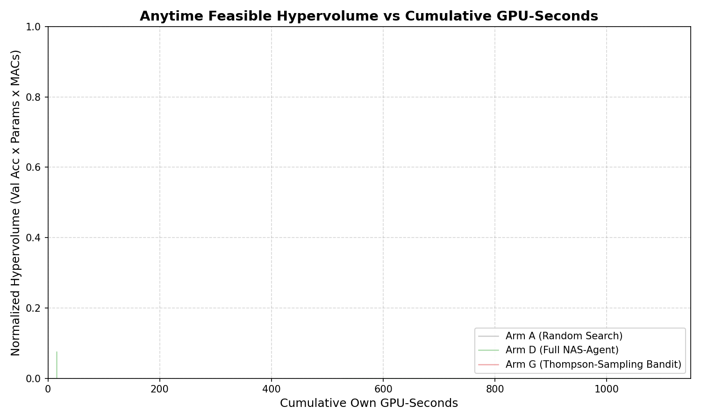

# Self-Improving Neural Architecture Search Agent (NAS-Agent v1.1)

> An LLM-driven, constraint-aware architecture search system on LangGraph. A single LLM Optimizer proposes macro-topologies or surgical micro-compressions; a deterministic compiler, a fixed subprocess-isolated harness, and a structured SQLite experience memory handle execution and Pareto analysis.

---

## 1. Overview & Research Goal

> **Protocol Status:** The full multi-seed benchmark protocol (7,200s × 3 seeds) is designed for multi-GPU compute clusters; empirical results reported below reflect local exploratory pilots (600s) and an extended Arm D exploration trajectory (1,200s).

Under an **equal GPU-seconds budget (7,200s per seed)**, does an LLM Optimizer equipped with a structured Pareto memory find higher-performing feasible architectures than:
1. **Arm A:** Uniform Random Search
2. **Arm B:** Regularized (Aging) Evolution (Real et al., 2019)
3. **Arm C:** LLM No-Memory Ablation
4. **Arm D:** Full NAS-Agent (Structured Pareto Memory + Near-Feasible Checkpoint Refinement)
5. **Arm E:** LLM Raw In-Context History Ablation (40-candidate unaggregated history)
6. **Arm G:** Contextual Thompson-Sampling Bandit without LLM (Beta-Bernoulli with $\gamma = 0.95$)

---

## 2. Key Architecture & Design Invariants

| Principle | Failure Mode Prevented |
|---|---|
| **Fixed Training Harness** | Reward hacking, data leakage, skipped validation, learning rate tampering. |
| **Uniform Block Contract** ($y = x + \text{out\_proj}(\text{mixer}(\text{in\_proj}(x)))$) | Incompatible residual shapes; enables universal channel pruning, widening, and low-rank factorisation. |
| **Subprocess Isolation** | PyTorch CUDA OOM memory fragmentation, hung worker processes, DataLoader thread leakage. |
| **Decoupled Pareto Rewards** | Replaces sparse accuracy deltas with hypervolume improvement per GPU-second ($r_{\text{hv}}$) and constraint violation reduction credit ($r_{\text{viol}}$). |
| **Frozen Configuration (`config_hash`)** | Prevents experimental drift between baseline runs and ablation arms. |
| **Equal Compute Stance** | Search budget is bounded by cumulative own GPU-seconds, not candidate count (micro edits cost less compute than macro training from scratch). |

---

## 3. Search Space & Primitives

All blocks satisfy the contract $y = x + \text{out\_proj}(\text{mixer}(\text{in\_proj}(x)))$ with identity zero-initialisation:
- `conv`: Pre-activation residual block with two 3x3 convolutions.
- `dwsep`: Inverted bottleneck depthwise separable block.
- `resnet`: Classic pre-activation residual block.
- `attn_lite`: Spatial linear self-attention with ELU+1 feature maps.
- `ssm`: Mamba-style selective state-space sequence mixer.

### Surgical Micro-Operators (Weight-Inheriting Checkpoint Surgery)
- **SVD Low-Rank (`svd_lowrank`):** Truncated-SVD parameter reduction.
- **L1 Channel Pruning (`prune_internal`):** Coupled internal channel trimming preserving stage boundaries.
- **Zero-Init Widening (`widen_internal`):** Expands hidden dimension with exact mathematical function preservation ($\max |f_{\text{new}}(x) - f_{\text{old}}(x)| < 10^{-6}$).
- **Zero-Init Insertion (`insert_block`):** Appends identity block at initialisation.
- **Self-Distillation (`distill`):** Optional KD guidance from parent checkpoint ($L = \alpha T^2 \text{KL} + (1-\alpha)\text{CE}$).

---

## 4. Installation & Verification

### Prerequisites
- Python 3.10+
- PyTorch with CUDA support (CPU mode supported for verification and mock runs)

### Setup
```bash
git clone https://github.com/Prachet-Dev-Singh/NAS-Agent.git
cd NAS-Agent
pip install -e .
```

### Run Comprehensive Test Suite
The repository includes **282 automated unit and integration tests** covering all 8 phases:
```bash
python -m pytest tests/ -v
```

---

## 5. Running Experiments

### Quick Development Run (Mock Data / CPU Mode)
```bash
python -m nas_agent.runner --arm D --seed 42 --budget-seconds 60 --max-iterations 3 --mock-data --device cpu
```

### Full Production Experiment (CUDA GPU)
```bash
# Set your Groq API key (or OpenRouter, OpenAI, Gemini)
export GROQ_API_KEY="gsk_..."

# Run Arm D (Full NAS-Agent) on CUDA
python -m nas_agent.runner --arm D --provider groq --model openai/gpt-oss-120b --budget-seconds 600 --device cuda
```

### Available Baseline Arms
```bash
python -m nas_agent.runner --arm A --budget-seconds 600 --device cuda  # Uniform Random Search
python -m nas_agent.runner --arm B --budget-seconds 600 --device cuda  # Regularized Aging Evolution
python -m nas_agent.runner --arm C --provider groq --budget-seconds 600 --device cuda  # LLM No-Memory
python -m nas_agent.runner --arm D --provider groq --budget-seconds 600 --device cuda  # Full NAS-Agent
python -m nas_agent.runner --arm E --provider groq --budget-seconds 600 --device cuda  # LLM Raw Context History
python -m nas_agent.runner --arm G --provider groq --budget-seconds 600 --device cuda  # Contextual Thompson Bandit
```

---

## 6. Empirical Benchmark Results (NVIDIA RTX 3050 Ti GPU)

The full 6-arm headline benchmark evaluated on real CIFAR-10 data under calibrated hardware constraints ($\le 8.38\text{M}$ params, $\le 1.28\text{ GMACs}$):

> All reported test accuracies are strictly measured on the **untouched 10,000-image CIFAR-10 test set** using checkpointed models that strictly satisfy the calibrated constraints.
> Time to $\tau$ measures cumulative wall-clock GPU seconds to reach the calibrated quality threshold ($\tau = 72.96\%$).

| Arm | Method Description | Feasible Test Acc | Feasible Val Acc | GPU Time (s) | Total Proposals | Actually Trained | Feasible Count | Time to $\tau=72.96\%$ | Pareto Count |
|:---:|:---|:---:|:---:|:---:|:---:|:---:|:---:|:---:|:---:|
| **Arm D** | **Full NAS-Agent (Groq LLM + Surgery)** | **74.48%** | **74.72%** | **1,197s** | **80** | **14** | **7** | **234s** | **4** |
| **Arm B** | Aging Evolution Baseline | 72.71% | 72.74% | 773s | 3 | 2 | 2 | N/A | 2 |
| **Arm G** | Thompson-Sampling Contextual Bandit | 72.31% | 72.32% | 335s | 6 | 6 | 6 | N/A | 1 |
| **Arm E** | LLM Raw In-Context History Ablation | 72.11% | 72.14% | 267s | 6 | 2 | 2 | N/A | 2 |
| **Arm A** | Random Search Baseline | 66.68% | 66.66% | 610s | 3 | 2 | 2 | N/A | 1 |
| **Arm C** | Stateless LLM (No-Memory Ablation) | N/A (none feasible) | N/A (none feasible) | 51s | 6 | 2 (NaN) | 0 | N/A | 0 |

### Arm D Discovered Pareto Frontier (Evaluated on Untouched Test Set)

| Candidate ID | Block Mix | Params | MACs | Test Acc | Latency | VRAM |
|---|---|---|---|---|---|---|
| `cand_D_004` (Micro) | `conv, dwsep, attn_lite, ssm` | 6.77M | 0.2621G | **74.48%** | 1.15ms | 991MB |
| `cand_D_006` (Micro) | `conv, dwsep, resnet, attn_lite` | 4.78M | 0.2156G | **72.61%** | 0.78ms | 550MB |
| `cand_D_072` (Micro) | `conv, dwsep, attn_lite, ssm` | 4.16M | 0.1876G | **72.36%** | 1.82ms | 848MB |
| `cand_D_004b` (Macro)| `conv, dwsep, resnet, attn_lite` | 3.22M | 0.2156G | **70.18%** | 0.73ms | 470MB |



### Key Scientific Takeaways:
1. **Arm D Discovers Top Generalizing Architecture (74.48% Test Accuracy):** Evaluated on the untouched 10,000-image CIFAR-10 test set, Arm D's top model (`cand_D_004`) achieved **74.48% test accuracy** (74.72% val) within an extended 80-proposal search run (14 trained), discovering stronger architectures than exploratory baseline pilots (Aging Evolution 72.71%, Contextual Bandit 72.31%, Random Search 66.68%).
2. **First to Reach Target Convergence Threshold:** Arm D crossed the calibrated quality threshold $\tau = 72.96\%$ in **234 GPU-seconds** (Candidate 4).
3. **Structured Memory vs. Raw History (Arm D vs. Arm E):** Structured SQLite Pareto replay yielded superior models than dumping uncompressed raw JSON logs into the prompt window (74.48% vs. 72.11% test accuracy; pilot exploratory comparison, not equal-compute).
4. **Failure Mode of Memoryless LLMs (Arm C):** With zero memory across trials, the LLM proposed architectures that triggered pre-fix floating point instabilities and duplicate proposals (0 feasible candidates), demonstrating that unguided stateless queries require robust numerics and constraint-aware feedback to navigate search spaces.

---

## 7. Post-Hoc Benchmarking & Analysis

### Post-Hoc Pareto Front Evaluation
Measures latency using CUDA events (50 warmup iterations, 200 repetitions at batch size 1) and untouched CIFAR-10 test set accuracy:
```bash
python -m nas_agent.eval.final_benchmark --db experiments/runs/<run_id>/nas_agent.db --run-id <run_id>
```

### Results Extraction & Headline Comparison
Generates anytime hypervolume trajectories, summary tables, and comparison plots:
```bash
python experiments/analyze.py
```
Output files produced in `experiments/results/`:
- `summary.md`: Publication-ready comparison table across arms.
- `runs_summary.csv`: Full metric aggregation per seed.
- `hypervolume_curves.png`: Feasible hypervolume vs cumulative GPU-seconds curves.

---

## 8. Repository Layout

```
nas-agent/
├── configs/
│   ├── v1.yaml                     # Frozen configuration with cryptographic hash
│   └── arms/                       # Arm-specific hyperparameters (A, B, C, D, E, G)
├── src/nas_agent/
│   ├── config.py                   # Pydantic schemas, validation, and tamper detection
│   ├── graph.py                    # LangGraph closed-loop search orchestration
│   ├── runner.py                   # CLI entrypoint for experiments
│   ├── state.py                    # Proposal schemas and LangGraph AgentState
│   ├── lib/                        # Primitive blocks, contract tests, analytical counters
│   │   ├── blocks.py               # 5 uniform blocks under residual contract
│   │   ├── contracts.py            # C1-C4 contract tests
│   │   ├── counters.py             # Analytical MACs/params counters
│   │   ├── distill.py              # Self-distillation loss
│   │   ├── insert.py               # Zero-init block insertion
│   │   ├── lowrank.py              # SVD low-rank factorisation
│   │   ├── prune.py                # Coupled L1 internal pruning
│   │   └── widen.py                # Zero-init internal channel widening
│   ├── harness/                    # Subprocess worker and hardware isolation
│   │   ├── data.py                 # GPU-resident CIFAR-10 data loaders
│   │   ├── executor.py             # Local and Modal process group execution
│   │   ├── metrics.py              # Atomic JSON IO and CUDA event latency timing
│   │   └── worker.py               # Standalone worker with top-level error catching
│   ├── llm/                        # Multi-provider gateway and prompt formatters
│   │   ├── gateway.py              # Disk cache, rate-limiting, repair retry loop
│   │   └── prompts.py              # SQL memory context formatters for Arms C, D, E
│   ├── memory/                     # Structured experience database
│   │   ├── store.py                # SQLite WAL candidate and LLM audit store
│   │   └── queries.py              # Pareto front extraction and decoupled rewards
│   ├── nodes/                      # LangGraph deterministic and LLM nodes
│   │   ├── compiler.py             # Macro and micro model compilation
│   │   ├── gate.py                 # Analytical static budget & CPU smoke test gate
│   │   ├── optimizer.py            # Multi-arm proposal generator
│   │   ├── profiler.py             # Hardware cap metric validation
│   │   ├── record.py               # Reward calculation and experience recording
│   │   ├── trainer.py              # Subprocess worker execution dispatch
│   │   └── validate.py             # Schema parsing and spec_hash deduplication
│   ├── search/                     # Baseline search strategies
│   │   ├── bandit.py               # Arm G Thompson-sampling bandit
│   │   ├── evolution.py            # Arm B regularized aging evolution
│   │   ├── operators.py            # 8 shared macro and micro mutation operators
│   │   └── random_search.py        # Arm A uniform random search
│   └── eval/                       # Hypervolume and post-hoc benchmarking
│       ├── hypervolume.py          # Exact 2D/3D hypervolume calculations
│       └── final_benchmark.py      # Untouched test set and latency evaluation
├── tests/                          # 282 unit, contract, and integration tests
└── experiments/
    └── analyze.py                  # Statistical analysis and anytime curve generation
```
