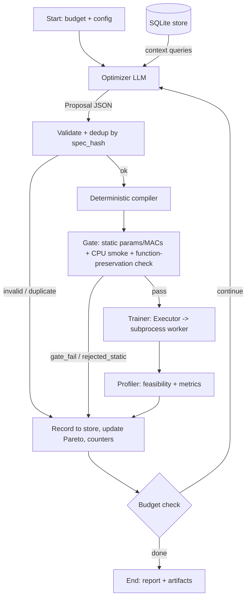

# Self-Improving NAS Agent: Project Blueprint v1.0 (Frozen)

> An LLM-driven, constraint-aware architecture search loop on LangGraph. A single LLM Optimizer proposes macro-architectures or surgical micro-compressions; a deterministic compiler, a fixed subprocess-isolated harness and a structured SQLite memory do everything else. Evaluated against random search and regularized evolution under equal GPU-seconds. Built on free LLM APIs.

---

## 0. TL;DR

- **What it is:** a closed loop where an LLM Optimizer emits typed JSON proposals, Python compiles them to PyTorch models (from your own primitive library), a fixed harness trains them in an isolated worker, and a deterministic Profiler decides feasibility against a hardware budget.
- **Research question:** *Under an equal GPU-seconds budget, does an LLM Optimizer with structured Pareto memory find better feasible architectures than random search, regularized evolution, and memory-ablated LLM variants?*
- **Two search modes:**
  - **Macro** proposals: new topology, trained from scratch.
  - **Micro** proposals: surgery on an existing checkpoint (low-rank, pruning, widening, block insertion, optional self-distillation), then short fine-tune.
- **Tier 1 (the whole MVP):** one LLM node (the Optimizer). No Coder LLM. Everything else is deterministic.
- **Tier 2 (stretch only):** opt-in Coder LLM writing new blocks under contract tests.
- **Free-API design:** about 1 LLM call per iteration, on-disk response cache, one pinned model per experiment, pause-and-resume on rate limits.
- **Total compute:** about 40-45 GPU-hours (Section 3.3), runnable on Modal credits plus Kaggle fallback.

---

## 1. Design principles (and what each one fixes)

| Principle | Fixes |
|---|---|
| **Fixed harness; the LLM never touches training, loss, or evaluation** | Reward hacking, data leakage, skipped validation |
| **Typed proposals + deterministic compiler (no Coder in Tier 1)** | Extra LLM hop, rate-limit pressure, schema-repair failures |
| **Macro vs micro split** | Weight inheritance is only valid for continuous or function-preserving edits, never across block-type swaps |
| **Uniform block contract** (Section 4.1) | Residual shape crashes; makes pruning, widening, and low-rank uniform across all five block families |
| **Run budget in GPU-seconds, not candidate count** | Micro candidates are cheaper than macro ones, so "80 candidates" is not equal compute |
| **Subprocess worker; worker-reported status wins** | CUDA OOM fragmentation, hangs, wrong OOM classification |
| **Structured SQLite memory (Chroma only as an ablation)** | Embeddings can't represent numeric outcomes or Pareto structure |
| **Calibrate once, then freeze** (`config_hash` on every row) | Proxy bias against attention/SSM, non-binding budgets, drifting results |
| **Latency is measured post-hoc on final fronts, not in the search loop** | Cloud-GPU timing noise and CUDA-graph failures contaminating search decisions |

---

## 2. Scope and research setup

### 2.1 In scope (MVP)

**Data (CIFAR-10):**
- Train pool: 40,000 images. Validation: 10,000 (fixed). Test: 10,000 (touched only for final fronts).
- **Proxy subset:** 10,000 stratified images from the train pool (fixed seed). All search-time training uses it.
- Normalization by train mean/std; augmentation is random crop (pad 4) + horizontal flip, done on the GPU.

**Search space:** five block families (`conv`, `dwsep`, `resnet`, `attn_lite`, `ssm`) with width, depth and expansion scaling, plus the micro operators in Section 4.3.

**Hardware budget** (`configs/budget.yaml`; numbers below are *initial placeholders*, finalized by the Phase 3 sampling rule):

| Constraint | Initial value | Role |
|---|---|---|
| `params_m` | <= 2.0 | hard |
| `macs_g` (GMACs, not FLOPs) | <= 0.15 | hard |
| `peak_vram_mb` (`max_memory_allocated`, batch 128, fp16 AMP) | <= 2048 | hard |
| `min_val_acc` | set in Phase 3 | hard floor |
| `latency_ms_bs1` | reported post-hoc | secondary, not a constraint |

**Budget-binding rule (Phase 3):** sample 200 random valid macro specs on CPU and count params/MACs. Set the MACs and params caps so **30-50% of random specs are infeasible**. A budget that isn't binding makes random search look good and the "strict constraints" story meaningless.

**Objective vector for Pareto and hypervolume:** `(val_acc ↑, macs_g ↓, peak_vram_mb ↓)`, over **feasible** candidates only.

### 2.2 Experimental arms (equal budget: 7,200 GPU-seconds per run, 3 seeds each)

| Arm | Description |
|---|---|
| **A** | Random search (macro + micro operators) |
| **B** | Regularized (aging) evolution, population 10, tournament size 3, same operators |
| **C** | LLM Optimizer, no memory (sees only the last result) |
| **D** | Full agent: LLM Optimizer + structured SQLite Pareto memory |
| **E** | LLM Optimizer + raw in-context history (last 40 candidate rows, no aggregates or Pareto summary) |

**Operator parity:** Arms A and B use the *same* macro and micro mutation operators as the LLM (micro with probability 0.3 on a random eligible parent), so differences come from the proposer, not operator access.

### 2.3 Stretch (only after the core results exist)
- Arm F: ChromaDB vector memory.
- Search-mode ablation: macro-only vs micro-only vs combined.
- Tier 2 (free-form block code with contract tests).
- `fake_quant_qat` with an `effective_model_bits` metric.
- Transfer of the best fronts to dense prediction (Cityscapes 128x256).
- Multi-fidelity search (successive halving).

### 2.4 Non-goals
- SOTA accuracy, large models, multi-node training.
- LLM-controlled hyperparameters, losses, or evaluation code.

---

## 3. Infrastructure

### 3.1 LLM gateway (`llm/gateway.py`, about 150 lines, written by you)

- **Providers:** decide at the start of Phase 6 by checking *current* free tiers. Candidates: Google AI Studio (a current Flash-tier model), Groq, Cerebras, OpenRouter `:free` models (including DeepSeek/Qwen variants when available), DeepSeek and Qwen (DashScope) direct APIs if you have free/trial quota. Re-verify model names; some older ones have been retired.
- **One pinned model per experiment.** All five arms that use an LLM (C, D, E and stretch F) use the *same* model ID. No silent mid-run failover.
- **Rate limits: pause and resume.** Because budgets are measured in GPU-seconds, not wall-clock, a run can simply sleep until the quota resets. Retry the *same* call on the *same* model with exponential backoff and jitter. A local Ollama model is a **dev-only** fallback, never used in reported runs.
- **Per-provider sliding-window limiter** (RPM and TPM).
- **Cache key:** `sha256(model_id, temperature, seed, system_prompt, user_prompt)`. The seed is in the key so seeds don't replay each other. Use temperature about 0.7 in experiments.
- **Logging** (`llm_calls` table): provider, exact model ID, tokens in/out, cache hit, repair count, timestamp, run_id.
- **Validation:** Pydantic parse, then up to 2 repair turns feeding back the validation error.
- **Fallback proposal:** after 3 consecutive invalid or duplicate proposals, the loop substitutes a random valid proposal flagged `fallback=true`. Report the fallback rate per arm (target < 5%).
- **Caps:** at most 600 LLM calls per run.

### 3.2 Execution: Modal and local, one contract

`harness/executor.py` defines `Executor.run(candidate) -> metrics`, with two implementations:
- **`ModalExecutor`:** the LangGraph orchestrator runs locally. The Trainer node calls a Modal function; *inside* that function, `run_training_worker` spawns the isolated subprocess. Parent checkpoints and artifacts live on a Modal Volume. Keep the container warm for the duration of a run (min-containers / scale-down-window settings) to avoid per-candidate cold starts.
- **`LocalExecutor`:** the same worker via plain subprocess, for Kaggle/Colab and CPU tests.

The LangGraph checkpointer (SQLite saver, for graph resume) is **separate** from the results store (`memory/store.py`).

### 3.3 Compute plan (GPU-hours, T4-class; verify per-candidate times in Phase 2)

| Item | Calculation | GPU-hours |
|---|---|---|
| LR-multiplier sweep | 5 families x 3 LRs x about 90 s | 0.4 |
| Seed noise floor | 5 runs x about 90 s | 0.1 |
| Proxy-validity check | 20 models x (about 90 s proxy + about 560 s reference) | 3.6 |
| Main runs | 5 arms x 3 seeds x 2.0 h | 30.0 |
| Pilots / dev | 3 x 0.5 h | 1.5 |
| Overhead (cold starts, retries) | about 15% | about 5.0 |
| **Total** | | **about 40-45** |

Stretch arms (F, search-mode ablation) add about 18 GPU-hours. Check current Modal free credits; Kaggle's weekly free GPU quota covers the rest.

Candidate cost assumptions: macro about 90 s (8 epochs on 10k images), micro about 45 s (4 epochs). CPU gate and static checks are free and not counted.

---

## 4. Search space and proposal schema

### 4.1 The uniform block contract

Every block is a residual unit: **`y = x + out_proj(mixer(in_proj(x)))`**, with hidden size `H = expand × width`.

| Block | `in_proj` | `mixer` (on H channels) | `out_proj` |
|---|---|---|---|
| `conv` | 3x3 conv C→H | identity | 3x3 conv H→C |
| `resnet` | 1x1 conv C→H | 3x3 conv H→H | 1x1 conv H→C |
| `dwsep` | 1x1 conv C→H | 3x3 depthwise conv | 1x1 conv H→C |
| `attn_lite` | linear C→H | linear-complexity multi-head attention, head dim 16 | linear H→C |
| `ssm` | linear C→H | depthwise conv1d + selective scan (state dim 8, per-channel params; parallel/chunked scan, fp32) | linear H→C |

**Macro layout:** stem (3x3 conv, stride 1) → 3-4 stages with strides `[1, 2, 2, 2]`. The first block of each stage has a non-prunable transition layer (stride and width change). Stage boundary widths are therefore fixed once a model exists.

**Placement rule:** stage 0 (32x32) allows only `conv`, `dwsep`, `resnet`. `attn_lite` and `ssm` are allowed from stage 1 on (at most 16x16 tokens).

This contract is what makes surgery safe: pruning, widening and low-rank touch only `H`, `in_proj` and `out_proj`, never stage boundaries or the skip path.

### 4.2 Proposal schemas

```python
from typing import Annotated, Literal, Union
from pydantic import BaseModel, Field, field_validator, model_validator

Block = Literal["conv", "dwsep", "resnet", "attn_lite", "ssm"]
EARLY_OK = {"conv", "dwsep", "resnet"}

class StageSpec(BaseModel):
    block: Block
    width: int = Field(..., ge=16, le=256)       # multiple of 16
    expand: int = Field(2, ge=1, le=4)           # H = expand * width
    depth: int = Field(..., ge=1, le=6)

    @field_validator("width")
    @classmethod
    def _mult16(cls, v):
        if v % 16: raise ValueError("width must be a multiple of 16")
        return v

class MacroProposal(BaseModel):
    kind: Literal["macro"] = "macro"
    stem_width: int = Field(32, ge=16, le=64)
    stages: list[StageSpec]
    norm: Literal["bn", "gn"] = "bn"
    activation: Literal["relu", "gelu", "silu"] = "silu"
    rationale: str = Field(..., max_length=400)

    @model_validator(mode="after")
    def _check(self):
        if not 3 <= len(self.stages) <= 4: raise ValueError("3-4 stages")
        if self.stages[0].block not in EARLY_OK: raise ValueError("stage 0 must be conv/dwsep/resnet")
        if sum(s.depth for s in self.stages) > 16: raise ValueError("total depth <= 16")
        return self

# ---- Micro operators (per-technique, bounded hparams) ----
class SVDLowRank(BaseModel):
    technique: Literal["svd_lowrank"]
    rank_ratio: float = Field(..., ge=0.1, le=0.9)
    which: Literal["in_proj", "out_proj", "both"] = "both"

class PruneInternal(BaseModel):
    technique: Literal["prune_internal"]
    sparsity: float = Field(..., ge=0.1, le=0.6)      # fraction of H removed (head-granular for attn)

class WidenInternal(BaseModel):
    technique: Literal["widen_internal"]
    factor: float = Field(..., ge=1.25, le=2.0)       # new H channels appended with zero-init out_proj

class InsertBlock(BaseModel):
    technique: Literal["insert_block"]
    block: Block                                      # appended to the stage, zero-init out_proj

Operator = Annotated[Union[SVDLowRank, PruneInternal, WidenInternal, InsertBlock],
                     Field(discriminator="technique")]

class Distill(BaseModel):
    enabled: bool = False
    alpha: float = Field(0.5, ge=0.3, le=0.9)
    temperature: float = Field(2.0, ge=1.0, le=4.0)

class MicroProposal(BaseModel):
    kind: Literal["micro"] = "micro"
    parent_id: str
    op: Operator
    target_stages: list[int]
    distill: Distill = Distill()                      # fine-tune with parent as teacher
    rationale: str = Field(..., max_length=400)

Proposal = Annotated[Union[MacroProposal, MicroProposal], Field(discriminator="kind")]
```

Stage indices, parent existence and placement rules are validated at compile time, not by the LLM.

### 4.3 Micro operators: semantics and guarantees

| Operator | Effect | Guarantee / contract test |
|---|---|---|
| `svd_lowrank` | Replace `in_proj`/`out_proj` weights by truncated-SVD factors | Full rank reproduces the original output (tolerance 1e-4). Never applied to mixer internals (depthwise conv, scan params) |
| `prune_internal` | Remove lowest-importance (L1) channels of `H`, coupled across `in_proj` out-channels, mixer params, `out_proj` in-channels and norms (heads for `attn_lite`, minimum H = 16) | Output shapes unchanged at stage boundaries; forward/backward pass |
| `widen_internal` | Append new `H` channels with **zero-initialized `out_proj` weights** | Function-preserving: max abs output diff < 1e-4 at init |
| `insert_block` | Append a block to a stage with zero-init `out_proj` | Identity at init (diff < 1e-4) |
| `distill` flag | Fine-tune the child with KD loss from the parent checkpoint | Not an architecture change; recorded on the row |

Quantization (`fake_quant_qat`) is stretch, because simulated quantization doesn't change params, MACs or VRAM and the agent couldn't observe its benefit.

**Runtime check:** the Gate verifies function preservation for `widen_internal` and `insert_block` on the actual checkpoint (CPU, fixed batch).

**Parent eligibility:** any trained candidate with a stored checkpoint and `val_acc >= min_val_acc`. Infeasible parents are explicitly allowed, since compression exists to turn near-feasible high-accuracy models into feasible ones.

**Checkpoint retention:** Pareto archive, the top 8 near-feasible candidates, and current parents. Others are deleted after 10 iterations.

**Micro fine-tune:** 4 epochs, LR multiplier 0.3x base peak, 1-epoch warmup, cosine decay.

**Cost accounting:**
- **Run budget** = sum of each candidate's *own* GPU-seconds (a parent is paid for when it's trained).
- `cumulative_gpu_seconds` (lineage-inclusive: own + ancestors') is a reporting metric: *cost to discover this architecture*. It stops compressed children from looking free when compared against from-scratch ones.

---

## 5. System architecture and loop control



Every outcome (valid, invalid, duplicate, static reject, crash, OOM, timeout, NaN, infeasible, feasible) goes through **Record**, so nothing is a dead end and nothing is free.

### 5.1 Nodes

| Node | Type | Responsibility |
|---|---|---|
| **Optimizer** | LLM | Context from SQL (Section 8), emits a `Proposal` JSON |
| **Validate + dedup** | Deterministic | Pydantic parse; `spec_hash` lookup; duplicates are returned to the Optimizer as "already evaluated" with their stored result |
| **Compiler** | Deterministic | `MacroProposal` → model; `MicroProposal` → surgery on loaded checkpoint |
| **Gate** | Deterministic | Static params/MACs vs caps (reject without GPU spend), CPU forward/backward on 2x3x32x32, function-preservation check |
| **Trainer** | Subprocess | Fixed harness (Section 6) |
| **Profiler** | Deterministic | Reads `metrics.json`, applies hard constraints and accuracy floor, classifies status |
| **Record** | Deterministic | Insert row, update Pareto flags, counters, dedup table |
| **Budget check** | Deterministic | Stop conditions below |

### 5.2 Status enum

`feasible`, `infeasible`, `rejected_static`, `gate_fail`, `duplicate`, `invalid`, `oom`, `timeout`, `nan`, `crash`.

### 5.3 Stop conditions

- **Experiment mode (reported runs):** stop only when own GPU-seconds >= 7,200, or LLM calls >= 600. **No stagnation early-stop**, because it would bias equal-compute comparisons.
- **Dev mode:** additionally stop on stagnation (no hypervolume gain in 25 trained candidates) or a wall-clock guard.

### 5.4 LangGraph state (compact; blobs stay on disk)

```python
class AgentState(TypedDict):
    run_id: str
    arm: Literal["A", "B", "C", "D", "E"]
    seed: int
    config_hash: str
    gpu_seconds_used: float
    gpu_seconds_budget: float          # 7200
    llm_calls_used: int
    iteration: int
    consecutive_invalid: int
    proposal: Optional[dict]           # current proposal JSON
    candidate_id: Optional[str]
    last_result: Optional[dict]        # compact summary (status, metrics, reasons)
    history: Annotated[list[dict], operator.add]   # short per-iteration summaries only
```

Code, logs and checkpoints are stored by reference (paths on the Volume). Trainer and Profiler are idempotent by `(spec_hash, config_hash, seed)`, so a resume never retrains a candidate.

---

## 6. Subprocess harness and profiling contract

### 6.1 Worker isolation

```python
import subprocess, os, signal, sys, json

def run_training_worker(candidate_id, spec_path, out_json, log_dir, timeout_sec=300) -> dict:
    out_log, err_log = f"{log_dir}/{candidate_id}.out", f"{log_dir}/{candidate_id}.err"
    with open(out_log, "w") as fo, open(err_log, "w") as fe:
        proc = subprocess.Popen(
            [sys.executable, "-m", "nas_agent.harness.worker", "--spec", spec_path, "--out", out_json],
            stdout=fo, stderr=fe, start_new_session=True)      # pid == pgid
        try:
            proc.wait(timeout=timeout_sec)
        except subprocess.TimeoutExpired:
            _kill_group(proc.pid); proc.wait()
            return {"status": "timeout", "error_tail": "exceeded timeout"}
        finally:
            _kill_group(proc.pid)                              # reap DataLoader / child leftovers

    result = try_read_json(out_json)
    if result is not None:
        return result                                          # worker-reported status wins (oom, nan, ...)
    return {"status": "crash",                                 # no JSON: segfault or host OOM-kill
            "error_tail": tail(err_log, 40), "returncode": proc.returncode}

def _kill_group(pid):
    try: os.killpg(pid, signal.SIGKILL)
    except ProcessLookupError: pass
```

**Worker contract (`harness/worker.py`):**
- Catches `torch.cuda.OutOfMemoryError` at top level, writes `{"status": "oom"}` to `metrics.json`, and exits 0. Does the same for NaN loss (`"nan"`) and other exceptions (`"crash"` plus a 40-line traceback tail).
- Writes `metrics.json` **incrementally** (per epoch) so partial data survives a hang.
- Never reads network or secrets. Hard timeout enforced by the parent.

### 6.2 Fixed training configuration (frozen after Phase 3, hashed into `config_hash`)

| Item | Value |
|---|---|
| Optimizer | AdamW, betas (0.9, 0.98), weight decay 1e-2 (none on norm/bias) |
| Base LR | 2e-3 (confirmed in Phase 3) |
| LR schedule | linear warmup then cosine to 1e-5 |
| Macro proxy | 8 epochs, 2-epoch warmup, 10k-image subset |
| Micro fine-tune | 4 epochs, 1-epoch warmup, LR x 0.3 |
| Batch size | 128 |
| Precision | fp16 AMP + GradScaler for all blocks; selective scan and norms in fp32; grad clip 1.0 |
| Data | whole subset resident on GPU; GPU-side augmentation (no DataLoader workers) |
| Seeds | fixed per candidate (derived from run seed + spec_hash) |

If the SSM or attention NaN rate exceeds 20% in Phase 2 contract/pilot runs, switch the *whole* harness to fp32 rather than special-casing blocks.

### 6.3 `metrics.json` schema

```json
{
  "status": "ok|oom|nan|crash|timeout",
  "val_acc": 0.0, "params_m": 0.0, "macs_g": 0.0, "peak_vram_mb": 0.0,
  "train_seconds": 0.0, "epochs_done": 0, "epoch_log": [],
  "error_tail": null, "spec_hash": "...", "config_hash": "...", "seed": 0,
  "env": {"torch": "...", "cuda": "...", "gpu": "..."}
}
```

`peak_vram_mb` is `torch.cuda.max_memory_allocated` (excludes the CUDA context); the budget uses these units consistently.

### 6.4 Latency (post-hoc only)

After each arm's run, benchmark the **final Pareto-front members** on one pinned GPU type:
- 50 warmup iterations, then 200 repetitions timed with CUDA events; report median and p95.
- Attempt CUDA-graph capture (or `torch.compile(mode="reduce-overhead")`); **record `latency_mode`** (`graph` or `eager`) and never mix modes within one comparison.
- Re-measure fronts within 10% of any latency target using 500 iterations.

---

## 7. Calibration protocol (Phase 3, then freeze)

All calibration happens once, before any agent run, and the outputs are written to `configs/v1.yaml`.

1. **Budget sampling (free, CPU):** 200 random valid specs → params/MACs distribution → set caps so 30-50% are infeasible.
2. **LR multipliers:** for each block family, train a homogeneous reference network at LR multipliers {0.5, 1, 2} x base. Fix one multiplier per family. At run time, parameter groups are **per block family** (stem, transitions and head at 1.0x), so mixed architectures get the right LR for each part.
3. **Noise floor:** train one fixed architecture with 5 seeds → `sigma_acc`. A difference below 2·`sigma_acc` is treated as noise (the Optimizer is told this in its prompt).
4. **Proxy validity:** 20 models sampled across the space (stratified by block family and size) → 8-epoch proxy accuracy vs a **reference run of 25 epochs on 20k images** (about 6x the compute).
   - Report Spearman ρ with a bootstrap CI, **plus partial correlation controlling for params**.
   - **Pass:** ρ >= 0.5 and partial correlation >= 0.3.
   - **If it fails**, in order: raise the proxy to 12 epochs, enlarge the subset to 20k, drop the worst-ranked block family or restrict the space, or move to successive halving.
5. **Threshold τ** for time-to-threshold: the 75th percentile of feasible random-sample proxy accuracies.
6. **Min accuracy floor** `min_val_acc`: the 25th percentile of the same distribution.
7. **Freeze:** write `configs/v1.yaml`, compute `config_hash`, and forbid harness/config edits afterward. Every row stores `config_hash`.

---

## 8. Structured experience memory and prompts

### 8.1 Store (SQLite, WAL mode; DuckDB only for analysis)

```sql
CREATE TABLE candidates (
    candidate_id TEXT PRIMARY KEY,
    run_id TEXT, arm TEXT, seed INT, iteration INT, config_hash TEXT,
    spec_hash TEXT, parent_id TEXT,
    proposal_type TEXT,                -- 'macro' | 'micro'
    technique TEXT,                    -- 'from_scratch' | 'svd_lowrank' | ...
    distill INT DEFAULT 0,
    block_types TEXT,                  -- e.g. 'conv,resnet,ssm'
    params_m REAL, macs_g REAL, peak_vram_mb REAL,
    val_acc REAL,
    latency_ms_median REAL, latency_ms_p95 REAL, latency_mode TEXT,  -- post-hoc only
    status TEXT,                       -- see 5.2
    own_gpu_seconds REAL, cumulative_gpu_seconds REAL,
    fallback INT DEFAULT 0, is_pareto INT DEFAULT 0,
    ckpt_ref TEXT, error_tail TEXT, spec_json TEXT, rationale TEXT
);
CREATE TABLE llm_calls (
    call_id TEXT PRIMARY KEY, run_id TEXT, provider TEXT, model_id TEXT,
    tokens_in INT, tokens_out INT, cache_hit INT, repair_count INT, ts TEXT
);
CREATE INDEX idx_spec ON candidates(spec_hash);
```

### 8.2 Optimizer context (deterministic SQL, capped at about 2k tokens)

1. **Budget and state:** caps, remaining GPU-seconds, `sigma_acc`.
2. **Pareto front** (feasible, non-dominated, top 12 by accuracy), with block types and metrics.
3. **Near-feasible parents** (checkpointed, accuracy above the floor, constraint violation ratio <= 1.5x), the natural micro-proposal targets.
4. **Technique statistics:** `GROUP BY technique, status`, with success rate and mean Δacc / ΔMACs / ΔVRAM for recent attempts.
5. **Last result** (and, if refining, the parent's metrics and per-stage parameter breakdown).
6. **Duplicate/invalid feedback** when applicable.

Arm C sees only (1) and (5). Arm E replaces (2)-(4) with the last 40 raw rows.

### 8.3 Optimizer prompt contract

```
Role: you propose ONE next architecture step for a constrained search.
Output: ONLY a JSON object matching the Proposal schema (macro or micro). No prose.
Rules: use only the allowed block/operator names; micro proposals must reference a
parent_id from the provided list; respect the hard caps; differences in val_acc
below {2*sigma} are noise; prefer micro moves on near-feasible parents when a
constraint is violated, and macro moves to explore new regions of the Pareto gap.
Never repeat a spec listed under "already evaluated".
```

Prompts are versioned in `llm/prompts/`, and the version ID is logged per call.

---

## 9. Evaluation

### 9.1 Metrics (all reported per seed; median and range across seeds)

- **Primary:** hypervolume of the feasible Pareto set vs cumulative own GPU-seconds (anytime curve), with `acc_norm = (acc − min_val_acc)/(1 − min_val_acc)`, `macs_norm = 1 − macs/cap`, `vram_norm = 1 − vram/cap`, so HV lives in the unit cube.
- Best feasible `val_acc` at 25%, 50% and 100% of the budget.
- **Time-to-threshold:** own GPU-seconds until the first feasible candidate with `val_acc >= τ`.
- **Validity rate:** share of proposals that pass Validate and Gate, plus the training-failure breakdown (oom, nan, crash, timeout), duplicate rate, fallback rate.
- **LLM cost:** calls and tokens per run, per feasible Pareto point.
- **Final fronts:** test accuracy (evaluated once) and post-hoc latency (Section 6.4).

### 9.2 Statistical stance

Three seeds per arm cannot support significance tests. Report every run, show spread, and claim an effect only when it is larger than the between-seed range. Say this explicitly in the write-up.

### 9.3 Ablations

- **Core:** Arm D vs Arm E (structured SQL memory vs raw history), and D vs C (memory vs none).
- **Stretch:** Arm F (Chroma), search-mode ablation, Tier 2.

### 9.4 Honest-reporting commitments
- Negative results are included. "Evolution matches the agent at lower cost" is a valid finding.
- Proxy-validity results (ρ, CI, partial correlation) appear in the main text.
- Report the model ID, prompt version and `config_hash` for each result table.

---

## 10. Repository layout

```
nas-agent/
  pyproject.toml
  README.md
  configs/
    budget.yaml  v1.yaml  arms/{A,B,C,D,E}.yaml
  src/nas_agent/
    state.py                  # Proposal schemas + AgentState + metrics models
    graph.py                  # LangGraph assembly, router, checkpointer
    nodes/
      optimizer.py  validate.py  compiler.py  gate.py  trainer.py  profiler.py  record.py
    llm/
      gateway.py  prompts/
    memory/
      store.py  queries.py
    lib/
      blocks.py               # five blocks under the uniform contract
      lowrank.py  prune.py  widen.py  distill.py
      contracts.py            # contract tests
      counters.py             # params / MACs
    search/
      operators.py            # shared macro+micro mutation operators (baselines)
      random_search.py  evolution.py
    harness/
      worker.py  data.py  metrics.py  executor.py  modal_app.py
    eval/
      hypervolume.py  final_benchmark.py
  tests/
    test_blocks.py  test_surgery.py  test_gateway.py  test_harness.py  test_store.py
  experiments/
    calibration/  runs/  analysis.ipynb
```

---

## 11. Roadmap and acceptance criteria

| Phase | Build | Done when |
|---|---|---|
| **1. Core library and compiler** | `blocks.py` (five blocks), `counters.py`, `compiler.py` (macro), CPU Gate, `state.py` schemas | All blocks pass shape/gradient tests; `MacroProposal` → model for 200 random specs; params/MACs counters match a reference counter |
| **2. Harness** | `worker.py`, `data.py`, `metrics.py`, `executor.py` (local + Modal) | A hand-written spec trains and returns valid `metrics.json`; forced OOM → `"oom"`; forced hang → `"timeout"`; second run after OOM has clean VRAM; per-candidate time measured |
| **3. Calibration and freeze** | Section 7 end to end | `configs/v1.yaml` written; budget is binding (30-50% infeasible); proxy validity passes (or remediation applied); `config_hash` locked |
| **4. Surgery (micro)** | `lowrank`, `prune`, `widen`, `insert_block`, `distill`, checkpointing, micro compiler | All contract tests pass for every block type: function preservation, coupled pruning shapes, SVD full-rank equivalence; micro fine-tune sanity run recovers accuracy |
| **5. Store and baselines** | `store.py`, `operators.py`, Arms A and B | A and B each complete a 7,200 GPU-second dev run, populate the DB, produce a valid Pareto front and hypervolume curve |
| **6. LLM gateway, Optimizer, graph** | `gateway.py`, prompts, LangGraph loop, Arms C/D/E | Gateway: cache + backoff + pause/resume tested; < 5% repair triggers; < 5% fallback; a full run resumes correctly from the graph checkpoint |
| **7. Pilot, then experiments** | 1 short pilot per arm, then all arms x 3 seeds | Pilots confirm no systematic failure; main runs complete; all artifacts and DBs saved |
| **8. Analysis and write-up** | Plots, tables, final-front test and latency evaluation, README | One command reproduces a headline table from stored runs; negative results documented |

**Build rule:** nothing LLM-related starts until Phase 5 produces a working baseline loop. The baselines are your measuring stick.

---

## 12. Risk register

| Risk | Likelihood | Mitigation |
|---|---|---|
| Free-tier limits or model retirement | High | Pinned model, pause-and-resume, cache, re-verify providers at Phase 6 |
| Weak LLM emits invalid proposals | High | Schema-bounded hparams, repair loop, fallback proposals, small prompts |
| Proxy ranking unreliable | Medium | Section 7 validity test with explicit remediation ladder |
| Budget not binding | Medium | 30-50% infeasible sampling rule |
| SSM/attention instability (fp16) | Medium | fp32 scan, NaN-rate check, harness-wide fp32 fallback |
| SSM scan dominates runtime | Medium | Parallel/chunked scan; GPU-seconds accounting handles the cost fairly |
| Credits exhausted | Medium | CPU gate + static rejects, persistent warm worker, Kaggle/Colab fallback via `LocalExecutor` |
| Results too noisy for conclusions | Medium | Noise floor, 3 seeds, descriptive claims only |
| Scope creep | High | Stretch items gated behind finished core results |

---

## 13. Appendix

### A. Frozen constants (set in Phase 3 unless noted)

| Constant | Source |
|---|---|
| `params`/`macs` caps | Phase 3 budget sampling |
| `min_val_acc` | Phase 3 (25th percentile) |
| `τ` (time-to-threshold) | Phase 3 (75th percentile) |
| Block LR multipliers | Phase 3 sweep |
| `sigma_acc` | Phase 3 noise floor |
| Proxy epochs / subset | Phase 3 (default 8 / 10k, remediation ladder if needed) |
| Run budget | 7,200 own GPU-seconds (fixed) |
| LLM call cap | 600 per run (fixed) |

### B. Changes from the previous draft

- Phases reordered (blocks and compiler before calibration; surgery after the harness is frozen).
- Run budget in GPU-seconds; lineage cost clarified as a reporting metric.
- Worker reports its own status; log paths per candidate; process-group kill.
- Latency moved to post-hoc final-front benchmarking.
- Quantization moved to stretch; distillation became a flag on micro proposals; widening is zero-init extension.
- Uniform block contract; per-technique bounded hparams.
- Graph dead-ends fixed; status enum expanded; dedup and fallback added.
- Cache key includes seed; one pinned model per experiment; pause-and-resume instead of failover.
- Evolution population 10; operator parity across arms; 3 seeds; Arm E added; compute budget corrected to about 40-45 GPU-hours.
- Proxy-validity test redesigned (n = 20, bootstrap CI, partial correlation, reference run, remediation ladder).
