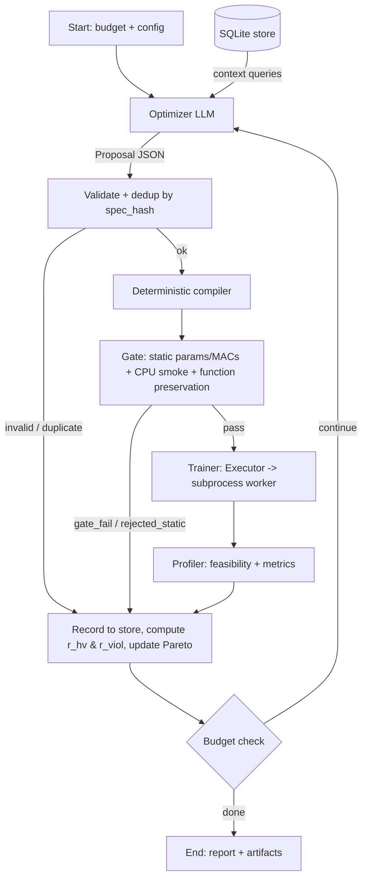

# Self-Improving NAS Agent: Project Blueprint v1.1 (Frozen)

> An LLM-driven, constraint-aware architecture search loop on LangGraph. A single LLM Optimizer proposes macro-architectures or surgical micro-compressions; a deterministic compiler, a fixed subprocess-isolated harness and a structured SQLite memory do everything else. Evaluated against random search, regularized evolution, and a Thompson-sampling contextual bandit under equal GPU-seconds. Built on free LLM APIs.

---

## 0. TL;DR

- **What it is:** A closed loop where an LLM Optimizer emits typed JSON proposals, Python compiles them to PyTorch models (from your own primitive library), a fixed harness trains them in an isolated subprocess worker, and a deterministic Profiler decides feasibility against a hardware budget.
- **Research question:** *Under an equal GPU-seconds budget, does an LLM Optimizer with structured Pareto memory find better feasible architectures than random search, regularized evolution, an operator-learning contextual bandit, and memory-ablated LLM variants?*
- **Two search modes:**
  - **Macro** proposals: topology edits on a parent or sampled from scratch, trained from scratch.
  - **Micro** proposals: surgery on an existing checkpoint (low-rank, pruning, widening, block insertion, optional self-distillation), followed by a short fine-tune.
- **Tier 1 (the whole MVP):** One LLM node (the Optimizer). No Coder LLM. Everything else is deterministic.
- **Tier 2 (stretch only):** Opt-in Coder LLM writing new block definitions under contract tests.
- **Free-API design:** About 1 LLM call per iteration, on-disk response cache, one pinned model per experiment, pause-and-resume on rate limits.
- **Total compute:** About 46–51 GPU-hours (Section 3.3), runnable on Modal credits plus Kaggle fallback.

---

## 1. Design Principles (and what each one fixes)

| Principle | Fixes |
|---|---|
| **Fixed harness; LLM never touches training, loss, or evaluation** | Reward hacking, data leakage, skipped validation, harness statefulness |
| **Typed proposals + deterministic compiler (no Coder in Tier 1)** | Extra LLM hop, rate-limit pressure, schema-repair failures |
| **Macro vs micro split** | Weight inheritance is only valid for continuous or function-preserving edits, never across block-type swaps |
| **Uniform block contract** (Section 4.1) | Residual shape crashes; makes pruning, widening, and low-rank uniform across all five block families |
| **Run budget in GPU-seconds, not candidate count** | Micro candidates are cheaper than macro ones; raw candidate counts do not reflect equal compute |
| **Subprocess worker; worker-reported status wins** | CUDA OOM fragmentation, hangs, DataLoader thread leakage, wrong OOM classification |
| **Structured SQLite memory (Chroma only as an ablation)** | Embeddings cannot represent numeric outcomes or Pareto dominance |
| **Decoupled Pareto reward & shaped violation credit** (Section 8.1) | Prevents incommensurable reward summing; replaces sparse accuracy deltas with Pareto signals |
| **Contextual Thompson-sampling bandit baseline (Arm G)** | Tests whether the LLM adds reasoning and targeted parameter selection beyond an operator-learning controller |
| **Calibrate once, then freeze** (`config_hash` on every row) | Proxy bias against attention/SSM, non-binding budgets, drifting experimental configs |
| **Latency measured post-hoc on final fronts** | Cloud-GPU virtualization timing jitter and CUDA-graph failures contaminating search decisions |

---

## 2. Scope and Research Setup

### 2.1 In Scope (MVP)

**Data (CIFAR-10):**
- Train pool: 40,000 images. Validation: 10,000 (fixed). Test: 10,000 (touched only for final fronts).
- **Proxy subset:** 10,000 stratified images from the train pool (fixed seed). All search-time training uses it.
- Normalization by train mean/std; augmentation is random crop (pad 4) + horizontal flip, done on GPU.

**Search Space:** Five block families (`conv`, `dwsep`, `resnet`, `attn_lite`, `ssm`) with width, depth and expansion scaling, plus the micro operators in Section 4.3.

**Hardware Budget** (`configs/budget.yaml`; initial values finalized by Phase 3 sampling rule):

| Constraint | Initial Value | Role |
|---|---|---|
| `params_m` | <= 2.0 | Hard cap |
| `macs_g` (GMACs, not FLOPs) | <= 0.15 | Hard cap |
| `peak_vram_mb` (`max_memory_allocated`, batch 128, fp16 AMP) | <= 2048 | Hard cap |
| `min_val_acc` | Set in Phase 3 (25th percentile) | Hard accuracy floor |
| `latency_ms_bs1` | Reported post-hoc on final front | Secondary benchmark |

**Budget-Binding Rule (Phase 3):** Sample 200 random valid macro specs on CPU and count params/MACs. Set the MACs and params caps so **30–50% of random specs are infeasible**.

**Objective Vector for Pareto and Hypervolume:** `(val_acc ↑, macs_g ↓, peak_vram_mb ↓)`, evaluated over **feasible** candidates only.

### 2.2 Experimental Arms (Equal Budget: 7,200 GPU-seconds per run, 3 seeds each)

| Arm | Description |
|---|---|
| **A** | Random search (uniform selection across macro + micro operators) |
| **B** | Regularized (aging) evolution, population 10, tournament size 3 |
| **C** | LLM Optimizer, no memory (sees only the last evaluated candidate) |
| **D** | Full agent: LLM Optimizer + structured SQLite Pareto memory & technique stats |
| **E** | LLM Optimizer + raw in-context history (last 40 rows with exact same reward columns as D) |
| **G** | **Contextual Bandit:** Thompson sampling (Beta-Bernoulli) learning operator selection conditioned on feasibility context (no LLM) |

**Operator Parity:** Arms A, B, and G use the *same* 8 macro and micro mutation operators as the LLM:
- **Macro (4):** `mutate_block`, `mutate_width`, `mutate_depth`, `mutate_expand` (mutates parent spec, trained from scratch).
- **Micro (4):** `svd_lowrank`, `prune_internal`, `widen_internal`, `insert_block` (inherits parent checkpoint, fine-tunes).

**Parent Selection Rule for Baseline Arms (A, B, G):**
- 50% probability: pick a uniformly chosen member from the current feasible Pareto front.
- 50% probability: pick a uniformly chosen near-feasible checkpoint ($v(x) \le 0.5$ and $\text{acc} \ge \text{min\_val\_acc}$).
- If archives are empty: sample a random valid macro spec from scratch.

### 2.3 Stretch (only after core results exist)
- Arm F: ChromaDB vector memory ablation.
- Search-mode ablation: macro-only vs micro-only vs combined.
- Tier 2: Free-form block code generation with Coder LLM and contract tests.
- Transfer of best discovered fronts to dense prediction (Cityscapes 128x256).

### 2.4 Non-Goals
- SOTA accuracy, large models, multi-node training.
- LLM-controlled hyperparameters, losses, or evaluation scripts.
- Stateful in-training early stopping that breaks harness idempotency.

---

## 3. Infrastructure

### 3.1 LLM Gateway (`llm/gateway.py`)
- **Providers:** Verified at the start of Phase 6. Candidates: Google AI Studio (Flash tier), Groq, Cerebras, OpenRouter `:free` tier.
- **One pinned model per experiment:** All LLM arms (C, D, E) use the *same* model ID throughout. No silent mid-run failovers.
- **Rate limits: pause and resume.** Because run budgets are measured in GPU-seconds, the loop sleeps until quotas reset. Retry the same call on the same model with exponential backoff.
- **Cache key:** `sha256(model_id, temperature, seed, system_prompt, user_prompt)`. Experiments run at temperature ~0.7.
- **Logging** (`llm_calls` table): Provider, exact model ID, tokens in/out, cache hit, repair count, timestamp, run_id.
- **Fallback proposal:** After 3 consecutive invalid or duplicate proposals, substitute a random valid proposal flagged `fallback=true` (target fallback rate < 5%).
- **Call cap:** At most 600 LLM calls per run.

### 3.2 Execution: Modal and Local
- **`ModalExecutor`:** Orchestrator runs locally. The Trainer node calls a Modal function; *inside* that function, `run_training_worker` spawns the isolated subprocess. Artifacts and checkpoints reside on a Modal Volume. Keep containers warm during a run to avoid cold-start overhead.
- **`LocalExecutor`:** Spawns worker via subprocess locally (for Kaggle/Colab and CPU tests).
- LangGraph checkpointer (SQLite saver for graph state resume) is strictly **separate** from the search results store (`memory/store.py`).

### 3.3 Compute Plan (GPU-Hours, T4-Class)

| Item | Calculation | GPU-Hours |
|---|---|---|
| LR-multiplier sweep | 5 families x 3 LRs x ~90s | 0.4 |
| Seed noise floor | 5 runs x ~90s | 0.1 |
| Proxy-validity check | 20 models x (~90s proxy + ~560s reference) | 3.6 |
| Main runs | 6 arms x 3 seeds x 2.0 h | 36.0 |
| Pilots / dev | 3 x 0.5 h | 1.5 |
| Overhead (cold starts, retries) | ~15% | ~5.0 |
| **Total** | | **~46–51** |

Candidate cost assumptions: Macro ~90s (8 epochs on 10k images), Micro ~45s (4 epochs). CPU gate and static checks are free and not counted.

---

## 4. Search Space and Proposal Schema

### 4.1 The Uniform Block Contract

Every block is a residual unit: **`y = x + out_proj(mixer(in_proj(x)))`**, with hidden size $H = \text{expand} \times \text{width}$.

| Block | `in_proj` | `mixer` (on $H$ channels) | `out_proj` |
|---|---|---|---|
| `conv` | 3x3 conv $C \to H$ | Identity | 3x3 conv $H \to C$ |
| `resnet` | 1x1 conv $C \to H$ | 3x3 conv $H \to H$ | 1x1 conv $H \to C$ |
| `dwsep` | 1x1 conv $C \to H$ | 3x3 depthwise conv | 1x1 conv $H \to C$ |
| `attn_lite` | Linear $C \to H$ | Linear multi-head attention (head dim 16) | Linear $H \to C$ |
| `ssm` | Linear $C \to H$ | Depthwise conv1d + selective scan (state dim 8, fp32) | Linear $H \to C$ |

**Macro layout:** Stem (3x3 conv, stride 1) $\to$ 3–4 stages with strides `[1, 2, 2, 2]`. The first block of each stage has a non-prunable transition layer. Stage boundary widths are fixed once a model exists. Stage 0 allows only `conv`, `dwsep`, `resnet`. `attn_lite` and `ssm` are permitted from stage 1 onwards ($\le 16 \times 16$ tokens).

### 4.2 Proposal Schemas

```python
from typing import Annotated, Literal, Union
from pydantic import BaseModel, Field, field_validator, model_validator

Block = Literal["conv", "dwsep", "resnet", "attn_lite", "ssm"]
EARLY_OK = {"conv", "dwsep", "resnet"}

class StageSpec(BaseModel):
    block: Block
    width: int = Field(..., ge=16, le=256)
    expand: int = Field(2, ge=1, le=4)
    depth: int = Field(..., ge=1, le=6)

    @field_validator("width")
    @classmethod
    def _mult16(cls, v):
        if v % 16: raise ValueError("width must be a multiple of 16")
        return v

class MacroProposal(BaseModel):
    kind: Literal["macro"] = "macro"
    stem_width: int = Field(32, ge=16, le=64)
    stages: list[StageSpec]
    norm: Literal["bn", "gn"] = "bn"
    activation: Literal["relu", "gelu", "silu"] = "silu"
    rationale: str = Field(..., max_length=400)

    @model_validator(mode="after")
    def _check(self):
        if not 3 <= len(self.stages) <= 4: raise ValueError("3-4 stages")
        if self.stages[0].block not in EARLY_OK: raise ValueError("stage 0 must be conv/dwsep/resnet")
        if sum(s.depth for s in self.stages) > 16: raise ValueError("total depth <= 16")
        return self

# ---- Micro operators (bounded hparams) ----
class SVDLowRank(BaseModel):
    technique: Literal["svd_lowrank"]
    rank_ratio: float = Field(..., ge=0.1, le=0.9)
    which: Literal["in_proj", "out_proj", "both"] = "both"

class PruneInternal(BaseModel):
    technique: Literal["prune_internal"]
    sparsity: float = Field(..., ge=0.1, le=0.6)

class WidenInternal(BaseModel):
    technique: Literal["widen_internal"]
    factor: float = Field(..., ge=1.25, le=2.0)

class InsertBlock(BaseModel):
    technique: Literal["insert_block"]
    block: Block

Operator = Annotated[Union[SVDLowRank, PruneInternal, WidenInternal, InsertBlock],
                     Field(discriminator="technique")]

class Distill(BaseModel):
    enabled: bool = False
    alpha: float = Field(0.5, ge=0.3, le=0.9)
    temperature: float = Field(2.0, ge=1.0, le=4.0)

class MicroProposal(BaseModel):
    kind: Literal["micro"] = "micro"
    parent_id: str
    op: Operator
    target_stages: list[int]
    distill: Distill = Distill()
    rationale: str = Field(..., max_length=400)

Proposal = Annotated[Union[MacroProposal, MicroProposal], Field(discriminator="kind")]
```

### 4.3 Micro Operators: Semantics & Guarantees

| Operator | Effect | Guarantee / Contract Test |
|---|---|---|
| `svd_lowrank` | Replaces `in_proj`/`out_proj` weights with truncated-SVD factors | Full rank reproduces original output within 1e-4 tolerance. Never applied to mixer internals |
| `prune_internal` | Removes lowest L1 channels of $H$, coupled across projection matrices | Stage boundary shapes unchanged; forward/backward pass verified |
| `widen_internal` | Appends new $H$ channels with **zero-initialized `out_proj` weights** | Function-preserving: max abs output difference < 1e-4 at init |
| `insert_block` | Appends a block with zero-init `out_proj` to a stage | Identity mapping at init (diff < 1e-4) |
| `distill` flag | Fine-tunes child with KD loss using parent as teacher | Recorded on candidate row |

**Micro Fine-Tune:** 4 epochs, LR multiplier 0.3x base peak, 1-epoch warmup, cosine decay.

---

## 5. System Architecture and Loop Control



### 5.1 Nodes

| Node | Type | Responsibility |
|---|---|---|
| **Optimizer** | LLM | Context from SQL (Section 8), emits a `Proposal` JSON |
| **Validate + dedup** | Deterministic | Pydantic parse; `spec_hash` lookup; duplicates returned as evaluated |
| **Compiler** | Deterministic | `MacroProposal` $\to$ model; `MicroProposal` $\to$ surgery on loaded checkpoint |
| **Gate** | Deterministic | Static params/MACs vs caps, CPU forward/backward (2x3x32x32), function-preservation check |
| **Trainer** | Subprocess | Fixed harness executed in isolated process group |
| **Profiler** | Deterministic | Reads `metrics.json`, applies caps and floor, classifies status |
| **Record** | Deterministic | Computes $r_{\text{hv}}$, $r_{\text{viol}}$, `success`; updates Pareto flags, counters, and dedup table |
| **Budget check** | Deterministic | Checks if `own_gpu_seconds >= 7200` or `llm_calls >= 600` |

### 5.2 Status Enum

`feasible`, `infeasible`, `rejected_static`, `gate_fail`, `duplicate`, `invalid`, `oom`, `timeout`, `nan`, `crash`.

### 5.3 LangGraph State

```python
class AgentState(TypedDict):
    run_id: str
    arm: Literal["A", "B", "C", "D", "E", "G"]
    seed: int
    config_hash: str
    gpu_seconds_used: float            # sum of candidate own_gpu_seconds
    gpu_seconds_budget: float          # 7200
    llm_calls_used: int
    iteration: int
    consecutive_invalid: int
    proposal: Optional[dict]
    candidate_id: Optional[str]
    last_result: Optional[dict]
    history: Annotated[list[dict], operator.add]
```

---

## 6. Subprocess Harness and Profiling Contract

### 6.1 Worker Isolation

```python
import subprocess, os, signal, sys

def run_training_worker(candidate_id, spec_path, out_json, log_dir, timeout_sec=300) -> dict:
    out_log, err_log = f"{log_dir}/{candidate_id}.out", f"{log_dir}/{candidate_id}.err"
    with open(out_log, "w") as fo, open(err_log, "w") as fe:
        proc = subprocess.Popen(
            [sys.executable, "-m", "nas_agent.harness.worker", "--spec", spec_path, "--out", out_json],
            stdout=fo, stderr=fe, start_new_session=True)      # pid == pgid
        try:
            proc.wait(timeout=timeout_sec)
        except subprocess.TimeoutExpired:
            _kill_group(proc.pid); proc.wait()
            return {"status": "timeout", "error_tail": "exceeded timeout"}
        finally:
            _kill_group(proc.pid)                              # reap child processes

    result = try_read_json(out_json)
    if result is not None:
        return result                                          # worker-reported status wins
    return {"status": "crash", "error_tail": tail(err_log, 40), "returncode": proc.returncode}

def _kill_group(pid):
    try: os.killpg(pid, signal.SIGKILL)
    except ProcessLookupError: pass
```

**Worker Contract:** Top-level handler catches `torch.cuda.OutOfMemoryError` $\to$ writes `{"status": "oom"}` and exits 0. Same for `"nan"` and exceptions (`"crash"`). Writes `metrics.json` incrementally per epoch.

### 6.2 Fixed Training Configuration (Frozen in Phase 3)

| Item | Value |
|---|---|
| Optimizer | AdamW, betas (0.9, 0.98), weight decay 1e-2 (none on norm/bias) |
| Base LR | 2e-3 (confirmed in Phase 3) |
| LR schedule | Linear warmup then cosine to 1e-5 |
| Macro proxy | 8 epochs, 2-epoch warmup, 10k-image subset |
| Micro fine-tune | 4 epochs, 1-epoch warmup, LR x 0.3 |
| Batch size | 128 |
| Precision | fp16 AMP + GradScaler; selective scan and norms in fp32; grad clip 1.0 |
| Data | Subset resident on GPU; GPU-side augmentation (no DataLoader threads) |
| Seeds | Fixed per candidate derived from `run_seed + spec_hash` |

*Note on Early Stopping:* Early stopping inside the harness is deliberately omitted to preserve harness idempotency and avoid confounding cross-arm comparisons. Every candidate trains for its full fixed epoch count (8 macro, 4 micro).

### 6.3 Latency (Post-Hoc Only)
Benchmark the final Pareto-front members on one pinned GPU type: 50 warmup iterations, 200 repetitions timed with CUDA events (median and p95). Record `latency_mode` (`graph` or `eager`).

---

## 7. Calibration Protocol (Phase 3, then Freeze)

1. **Budget sampling (CPU):** 200 random specs $\to$ set caps so 30–50% are infeasible.
2. **LR multipliers:** 3-value LR grid sweep per block family on reference networks $\to$ freeze per-block multipliers.
3. **Noise floor:** Fixed architecture trained with 5 seeds $\to \sigma_{\text{acc}}$.
4. **Proxy validity:** 20 models across search space $\to$ 8-epoch proxy vs 25-epoch/20k-image reference. Pass criteria: Spearman $\rho \ge 0.5$ and partial correlation (controlling for params) $\ge 0.3$.
5. **Thresholds:** $\tau$ (75th percentile of feasible proxy accuracy) and `min_val_acc` (25th percentile).
6. **Freeze:** Write `configs/v1.yaml`, compute `config_hash`, and lock all code.

---

## 8. Structured Experience Memory, Rewards & Baselines

### 8.1 Decoupled Reward Formulation

To avoid incommensurable summation, we define two clean, independent signals:

1. **Hypervolume Improvement per GPU-Second:**
   $$r_{\text{hv}} = \frac{\text{HV}_{\text{after}} - \text{HV}_{\text{before}}}{\text{own\_gpu\_seconds}}$$
   *(Note: $\text{HV}$ of a monotonically growing non-dominated archive never decreases).*

2. **Constraint Violation Ratio:**
   $$v(x) = \max_{m \in \{\text{params}, \text{macs}, \text{vram}\}} \max\left(0, \frac{\text{metric}_m(x)}{\text{cap}_m} - 1\right)$$
   For micro-moves on an infeasible parent, the reduction in violation is:
   $$r_{\text{viol}} = \max(0, v(x_{\text{parent}}) - v(x_{\text{child}}))$$
   *(Restoring full feasibility yields $r_{\text{viol}} = v(x_{\text{parent}})$. Macro moves train from scratch and receive $r_{\text{viol}} = 0$).*

3. **Success Definition:**
   $$\text{success} = (\Delta \text{HV} > 0) \lor (r_{\text{viol}} > 0 \land \text{val\_acc} \ge \text{min\_val\_acc})$$

### 8.2 Database Schema (SQLite)

```sql
CREATE TABLE candidates (
    candidate_id TEXT PRIMARY KEY,
    run_id TEXT, arm TEXT, seed INT, iteration INT, config_hash TEXT,
    spec_hash TEXT, parent_id TEXT,
    proposal_type TEXT,                -- 'macro' | 'micro'
    technique TEXT,                    -- 'from_scratch', 'svd_lowrank', etc.
    distill INT DEFAULT 0,
    block_types TEXT,
    params_m REAL, macs_g REAL, peak_vram_mb REAL,
    val_acc REAL,
    latency_ms_median REAL, latency_ms_p95 REAL, latency_mode TEXT,
    status TEXT,
    own_gpu_seconds REAL, cumulative_gpu_seconds REAL,
    r_hv REAL DEFAULT 0.0,
    r_viol REAL DEFAULT 0.0,
    success INT DEFAULT 0,
    fallback INT DEFAULT 0, is_pareto INT DEFAULT 0,
    ckpt_ref TEXT, error_tail TEXT, spec_json TEXT, rationale TEXT
);
CREATE TABLE llm_calls (
    call_id TEXT PRIMARY KEY, run_id TEXT, provider TEXT, model_id TEXT,
    tokens_in INT, tokens_out INT, cache_hit INT, repair_count INT, ts TEXT
);
CREATE INDEX idx_spec ON candidates(spec_hash);
```

### 8.3 Optimizer Prompt Context (Deterministic SQL)

1. **Budget and state:** Caps, remaining GPU-seconds, $\sigma_{\text{acc}}$.
2. **Pareto front:** Up to 12 non-dominated feasible candidates with block types and metrics.
3. **Near-feasible parents:** Checkpointed models with $\text{acc} \ge \text{min\_val\_acc}$ and $v(x) \le 0.5$.
4. **Technique statistics:** For each technique over the last 15 attempts:
   - Success rate: share of attempts with `success = 1`.
   - **Median** $r_{\text{hv}}$: Using medians (not means) prevents the first-feasible candidate spike from dominating the prompt.
5. **Last result:** Metrics, reasons, and parent breakdown if refining.

*Arm E Parity:* Arm E receives the raw last 40 rows including `r_hv`, `r_viol`, and `success`, ensuring that the difference between Arm D and Arm E isolates structured SQL aggregation versus raw context, not information content.

### 8.4 Arm G: Thompson-Sampling Contextual Bandit Specification

Arm G learns operator selection without an LLM:
- **Operators (8):** Macro (`mutate_block`, `mutate_width`, `mutate_depth`, `mutate_expand`) and Micro (`svd_lowrank`, `prune_internal`, `widen_internal`, `insert_block`).
- **Context Space (2):** `Context = feasible` or `Context = infeasible` (collapsed to avoid sample starvation across 80–100 pulls).
- **Posterior Updates:** Beta-Bernoulli distributions $\text{Beta}(\alpha_{c, k}, \beta_{c, k})$ with discount factor $\gamma = 0.95$ to handle non-stationarity as the Pareto front fills:
  $$\alpha_{c, k} \leftarrow 0.95 \cdot \alpha_{c, k} + \text{success}$$
  $$\beta_{c, k} \leftarrow 0.95 \cdot \beta_{c, k} + (1 - \text{success})$$
- **Decision Rule:** Sample $\theta_{c, k} \sim \text{Beta}(\alpha_{c, k}, \beta_{c, k})$ and pick operator:
  $$k^* = \arg\max_k \frac{\theta_{c, k}}{\mathbb{E}[\text{cost}_k]}$$
  where $\mathbb{E}[\text{cost}_k]$ is initialized to 90s for macro and 45s for micro, and updated online via exponential moving average.
- **Fairness Stance:** Arm G selects the operator, while its target modules and hyperparameters are sampled randomly. The comparison between Arm D and Arm G tests whether the LLM's directed parameter selection adds value beyond a bandit operator controller.

---

## 9. Evaluation

### 9.1 Metrics (Reported per seed; median and range across seeds)
- **Primary:** Hypervolume of feasible Pareto set vs cumulative own GPU-seconds (anytime curve) in normalized unit cube.
- **Best feasible `val_acc`** at 25%, 50%, and 100% of budget.
- **Time-to-threshold:** Own GPU-seconds until first feasible candidate with $\text{acc} \ge \tau$.
- **Validity rate:** Proposals passing Gate, plus failure breakdowns (oom, nan, crash, timeout), fallback rate.
- **LLM cost:** Calls and tokens per feasible Pareto point.
- **Final fronts:** Test accuracy and post-hoc latency.

### 9.2 Statistical Stance
With 3 seeds per arm, we do not claim statistical significance tests. We report every run, display spreads, and claim an effect only when it exceeds the between-seed variation.

---

## 10. Repository Layout

```
nas-agent/
  pyproject.toml
  README.md
  configs/
    budget.yaml  v1.yaml  arms/{A,B,C,D,E,G}.yaml
  src/nas_agent/
    state.py                  # Schemas + AgentState
    graph.py                  # LangGraph assembly & router
    nodes/
      optimizer.py  validate.py  compiler.py  gate.py  trainer.py  profiler.py  record.py
    llm/
      gateway.py  prompts/
    memory/
      store.py  queries.py
    lib/
      blocks.py               # Five blocks under uniform contract
      lowrank.py  prune.py  widen.py  distill.py
      contracts.py            # Contract tests
      counters.py             # Analytical MACs/params
    search/
      operators.py            # Shared macro + micro mutation operators
      random_search.py  evolution.py  bandit.py
    harness/
      worker.py  data.py  metrics.py  executor.py  modal_app.py
    eval/
      hypervolume.py  final_benchmark.py
  tests/
    test_blocks.py  test_surgery.py  test_gateway.py  test_harness.py  test_store.py  test_bandit.py
  experiments/
    calibration/  runs/  analysis.ipynb
```

---

## 11. Roadmap and Acceptance Criteria

| Phase | Build | Done When |
|---|---|---|
| **1. Core library and compiler** | `blocks.py` (5 blocks), `counters.py`, `compiler.py`, CPU Gate, `state.py` | All blocks pass shape/gradient tests; 200 random specs compile; params/MACs counters match reference |
| **2. Harness** | `worker.py`, `data.py`, `metrics.py`, `executor.py` | Hand-written spec trains and returns `metrics.json`; forced OOM $\to$ `"oom"`; forced hang $\to$ `"timeout"`; subprocess isolation verified |
| **3. Calibration and freeze** | Section 7 protocol end to end | `configs/v1.yaml` written; budget is binding (30–50% infeasible); proxy validity passes; `config_hash` locked |
| **4. Surgery (micro)** | `lowrank`, `prune`, `widen`, `insert_block`, `distill`, micro compiler | All contract tests pass: function preservation (<1e-4), coupled pruning shapes, SVD full-rank equivalence |
| **5. Store and baselines** | `store.py`, `operators.py`, Arms A, B, and G | Arms A, B, and G complete 7,200 GPU-second dev runs; Thompson sampling updates verified; Pareto curves generated |
| **6. LLM gateway, Optimizer, graph** | `gateway.py`, prompts, LangGraph loop, Arms C/D/E | Gateway cache + backoff tested; <5% repair triggers; full run resumes from graph checkpoint |
| **7. Pilots & main experiments** | 1 pilot per arm, then 6 arms x 3 seeds | Pilots confirm no systematic crashes; 18 runs complete; all SQLite databases preserved |
| **8. Analysis and write-up** | Hypervolume curves, tables, post-hoc latency, README | One command reproduces headline tables from stored DBs; honest reporting of findings |

---

## 12. Risk Register

| Risk | Likelihood | Mitigation |
|---|---|---|
| Free-tier limits or model retirement | High | Pinned model, pause-and-resume, disk cache, re-verify providers at Phase 6 |
| Weak LLM emits invalid proposals | High | Bounded Pydantic schemas, repair loop, fallback proposals, small prompt context |
| Proxy ranking unreliable | Medium | Section 7 validity check with explicit remediation ladder |
| Budget not binding | Medium | 30–50% infeasible CPU sampling rule |
| SSM/attention instability (fp16) | Medium | fp32 scan, NaN-rate check, harness-wide fp32 fallback |
| Bandit sample starvation | Low | Collapsed 2-context space (16 cells total), Beta discounting $\gamma = 0.95$ |
| Credits exhausted | Medium | CPU gate rejects, warm worker container, Kaggle/Colab fallback via `LocalExecutor` |
| Scope creep | High | Strictly freeze v1.1; stretch items gated behind finished core results |

---

## 13. Appendix: Frozen Constants (Phase 3)

| Constant | Source |
|---|---|
| `params_m` / `macs_g` / `peak_vram_mb` caps | Phase 3 budget sampling |
| `min_val_acc` | Phase 3 (25th percentile) |
| $\tau$ (time-to-threshold) | Phase 3 (75th percentile) |
| Block LR multipliers | Phase 3 sweep |
| $\sigma_{\text{acc}}$ | Phase 3 noise floor |
| Proxy epochs / subset | Fixed at 8 epochs / 10,000 images |
| Run budget | 7,200 own GPU-seconds (fixed) |
| LLM call cap | 600 calls per run (fixed) |
| Bandit discount factor $\gamma$ | 0.95 (fixed) |
| Bandit cost priors | 90s (macro), 45s (micro) |
| Baseline parent selection ratio | 50% Pareto archive, 50% near-feasible |
