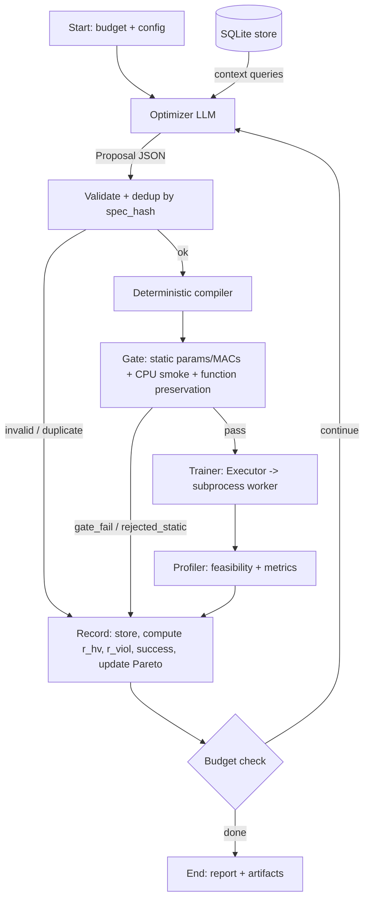

# Self-Improving NAS Agent: Complete Study Guide

> Companion to **Blueprint v1.1**. It explains *what* you are building, *why* every piece exists, *how* it works end to end, the theory behind each part, the practical details for building it, and a fully worked example with numbers.
>
> **Note on numbers:** all numbers in the worked example (Part 6) and in small illustrations are **made up for teaching**. They are consistent with each other and with the blueprint's formulas, but they are not predictions of real results.

---

## Table of Contents

0. [Orientation: the 60-second mental model](#part-0)
1. [The problem you are solving](#part-1)
2. [Theory foundations](#part-2)
3. [The system end to end](#part-3)
4. [Evaluation: what the experiments actually test](#part-4)
5. [Practical build guide](#part-5)
6. [Worked example: one run, step by step](#part-6)
7. [Subtle points and decisions to settle while building](#part-7)
8. [Cheat sheet, glossary, self-quiz, study plan](#part-8)

---

<a id="part-0"></a>
## Part 0. Orientation: the 60-second mental model

**One sentence:** you are building an automated "architecture engineer": a loop in which an LLM proposes a neural-network design, ordinary Python builds and trains it in a sandbox, a measuring harness reports accuracy and hardware cost, and a database remembers everything so the next proposal is better informed. You then run it against simpler non-LLM searchers to find out whether the LLM actually helps.

**The analogy:**

| Real-world role | In your project |
|---|---|
| Boss with a budget | Hardware caps (params, MACs, VRAM) and a GPU-seconds budget |
| Junior engineer with ideas | The **Optimizer LLM** (proposes designs) |
| Workshop with fixed tools nobody may modify | The **harness** (training and evaluation code the LLM can never touch) |
| Lab notebook | The **SQLite store** (every attempt, its numbers, its rewards) |
| Inspector | The **Gate** and **Profiler** (deterministic checks) |
| Rival engineers | **Arms A, B, G** (random, evolution, bandit): the controls that tell you if the junior engineer is actually good |

**The loop in seven verbs:** *propose → validate → compile → check → train → measure → record* (then decide whether to continue).

**The one research question:** under the same GPU-seconds budget, does the LLM-with-memory find better feasible architectures than random search, evolution, and a statistical bandit?

**Why it is a "project" and not a demo:** a defined search space, a frozen evaluation protocol, equal-compute baselines, and ablations. Without those, it would just be "an LLM edits PyTorch."

---

<a id="part-1"></a>
## Part 1. The problem you are solving

### 1.1 What are you searching for?

A neural network that is **accurate** and also **cheap**. On CIFAR-10 you want a small image classifier that satisfies hard limits:

| Metric | Meaning | Initial cap |
|---|---|---|
| `params_m` | Number of weights, in millions | <= 2.0 |
| `macs_g` | Multiply-accumulate operations per image, in billions (a compute-cost proxy independent of the GPU) | <= 0.15 |
| `peak_vram_mb` | Peak GPU memory during training (batch 128, fp16) | <= 2048 |
| `val_acc` | Validation accuracy | >= `min_val_acc` (floor) |

A candidate that meets all of these is **feasible**. A candidate that violates a cap is **infeasible**. Among feasible candidates you want the best trade-off between accuracy, MACs and VRAM, which is a **multi-objective** problem (Part 2.2).

### 1.2 Why is this hard?

1. **The space is huge.** Block types, widths, depths, expansions, stage counts: millions of combinations.
2. **Each evaluation costs real compute.** Training a candidate takes about 90 seconds on a T4. You can afford only about 80-100 per run (7,200 GPU-seconds).
3. **Measurements are noisy.** Same architecture, different seed: accuracy differs by roughly +/- sigma_acc. Short proxy training is also an imperfect predictor of fully trained quality.
4. **Constraints bite.** Many promising big models violate a cap, so "just make it more accurate" fails.

### 1.3 Why use an LLM?

An LLM carries **prior knowledge** about architectures (what a bottleneck is, why depthwise convs are cheap) and can **read a structured history** and make a directed edit ("VRAM is too high in stage 0, prune the hidden channels there"). Random search cannot do that.

What the LLM is **not** trusted with: writing training code, losses, hyperparameters, or evaluation. If it could, it could (accidentally or deliberately) game the metric. The blueprint therefore restricts it to emitting **typed JSON proposals** that Python validates and compiles.

### 1.4 What does "self-improving" mean here?

No model weights of the LLM change (you use free hosted APIs). Self-improvement comes from the **loop**:

- Every result is written to a database with **reward signals** attached.
- The next prompt contains **summaries of what worked** (technique statistics, the current Pareto front).
- In Arm G, a **Thompson-sampling bandit** literally updates its beliefs about which operator works in which situation.

So: *feedback → memory → better next proposal*. That is the self-correcting part.

### 1.5 What you are not building

- Not a state-of-the-art classifier.
- Not an LLM that writes arbitrary training pipelines (that is stretch "Tier 2").
- Not a deep-RL policy trained with PPO (rejected: too few samples, noisy reward, frozen LLM).

---

<a id="part-2"></a>
## Part 2. Theory foundations

Each subsection gives the theory, then the practical consequence for your project.

### 2.1 Neural Architecture Search (NAS)

NAS has three ingredients:

1. **Search space**: the set of architectures you allow. Yours: 3-4 stages, each with a block type from {conv, dwsep, resnet, attn_lite, ssm}, a width, an expansion, a depth, plus micro-edits on trained checkpoints.
2. **Search strategy**: how you pick the next candidate (random, evolution, bandit, LLM).
3. **Evaluation strategy**: how you score a candidate cheaply (here: short **proxy training**: 8 epochs on 10,000 images).

Your project fixes (1) and (3) and varies (2). That is why comparisons are fair: **only the proposer changes**.

### 2.2 Multi-objective optimization: Pareto dominance and hypervolume

With several objectives there is rarely a single "best" model.

**Dominance:** candidate X *dominates* Y if X is at least as good on every objective and strictly better on at least one. Objectives here: accuracy (higher is better), MACs (lower), VRAM (lower).

**Pareto front:** the set of candidates not dominated by any other candidate. Every point on it is a different trade-off ("most accurate", "cheapest", "balanced").

**Hypervolume (HV):** a single number that measures how good a front is: the volume of objective space dominated by the front, measured from a reference point. Bigger is better. It rewards both *quality* and *spread*, and it is the primary metric of the project.

**Normalization into a unit cube** (so all three axes are "higher is better" and comparable):

```
acc_norm  = (val_acc - min_val_acc) / (1 - min_val_acc)
macs_norm = 1 - macs_g / macs_cap
vram_norm = 1 - peak_vram_mb / vram_cap
reference point = (0, 0, 0)       # worst acceptable corner
```

Only **feasible** candidates enter the front (a feasible candidate has all three norms in [0, 1]).

**Computing 3D hypervolume (exact, small fronts):** slice along one axis and sum 2D areas.

```python
def hv2d(points):                       # points: (x, y), maximize both, ref=(0,0)
    pts = sorted(points, key=lambda p: -p[0])
    area, max_y = 0.0, 0.0
    for i, (x, y) in enumerate(pts):
        max_y = max(max_y, y)
        x_next = pts[i + 1][0] if i + 1 < len(pts) else 0.0
        area += (x - x_next) * max_y
    return area

def hv3d(points):                       # points: (acc_n, macs_n, vram_n)
    pts = sorted(points, key=lambda p: -p[2])
    vol = 0.0
    for i, p in enumerate(pts):
        z_hi = p[2]
        z_lo = pts[i + 1][2] if i + 1 < len(pts) else 0.0
        active = [(q[0], q[1]) for q in pts[:i + 1]]   # all have vram_n >= z_hi
        vol += hv2d(active) * (z_hi - z_lo)
    return vol
```

Property you rely on: HV of a growing archive **never decreases**, so "HV after minus HV before" is always >= 0.

### 2.3 Proxy training, rank correlation, and noise

**Proxy training** trains for few epochs on a small subset so each candidate costs about 90 s instead of hours. Danger: the *ranking* of candidates under the proxy may differ from the ranking after full training.

**Spearman rank correlation (rho)** measures how well two rankings agree (+1 identical, 0 unrelated). Tiny example: proxy ranks `[1,2,3,4,5]` vs reference ranks `[2,1,3,5,4]` → differences d = `[-1, 1, 0, -1, 1]`, sum of d² = 4:

```
rho = 1 - 6 * sum(d^2) / (n * (n^2 - 1)) = 1 - 6*4 / (5*24) = 0.8
```

**Partial correlation controlling for params:** bigger models tend to score higher under both budgets, which inflates rho. The partial correlation removes the effect of model size, so you know the proxy ranks *quality*, not just *size*. Phase 3 pass rule: rho >= 0.5 **and** partial correlation >= 0.3.

**Noise floor sigma_acc:** train one fixed architecture with 5 seeds and take the standard deviation of val_acc. Differences smaller than about 2·sigma are noise. The Optimizer is told this in its prompt so it doesn't chase noise.

**Optimizer-schedule bias (why calibration exists):** conv blocks converge fast with a given learning rate; attention and SSM blocks need different warmup/LR. With one fixed LR for all, attention/SSM would look worse than they are. Phase 3 therefore finds a **per-block-family LR multiplier** once and freezes it.

### 2.4 The five block families

All five follow one **uniform contract**: `y = x + out_proj( mixer( in_proj(x) ) )`, hidden size `H = expand × width`.

| Block | in_proj | mixer | out_proj | Intuition |
|---|---|---|---|---|
| `conv` | 3x3 conv C→H | identity | 3x3 conv H→C | Plain local feature extractor |
| `resnet` | 1x1 conv C→H | 3x3 conv H→H | 1x1 conv H→C | Bottleneck-style residual unit |
| `dwsep` | 1x1 conv C→H | 3x3 **depthwise** conv | 1x1 conv H→C | Cheap spatial mixing per channel, then 1x1 mixes channels (MobileNet idea) |
| `attn_lite` | linear C→H | linear-complexity multi-head attention (head dim 16) | linear H→C | Global mixing across spatial positions |
| `ssm` | linear C→H | depthwise conv1d + selective scan (state dim 8) | linear H→C | State-space sequence model (Mamba-style): spatial map flattened into a sequence and scanned |

**Why a uniform contract?** Surgery (pruning, widening, low-rank) only ever touches `H`, `in_proj` and `out_proj`. The skip connection and the stage's output width are never changed, so the classic crash "cannot add [B,64,H,W] to [B,48,H,W]" becomes impossible by construction.

**Cost formulas (params; multiply by spatial positions to get MACs):**

| Block | Params (ignoring norms) |
|---|---|
| `conv` | 9·C·H + 9·H·C = 18·C·H |
| `resnet` | C·H + 9·H² + H·C = 2·C·H + 9·H² |
| `dwsep` | C·H + 9·H + H·C = 2·C·H + 9·H |
| `attn_lite`, `ssm` | depend on your implementation (q/k/v projections, scan parameters); count them in `counters.py` |

**Worked cost example:** a `resnet` block with C = 64, expand = 2 (so H = 128) at a 16×16 stage:

```
in_proj : 64*128      =   8,192 params
mixer   : 9*128*128   = 147,456 params
out_proj: 128*64      =   8,192 params
total                 = 163,840 params
MACs = params * 256 positions = 41,943,040 ≈ 41.9 M MACs
```

Two such blocks already cost about 84 M MACs. With a cap of 0.15 G (150 M), this shows why the MACs budget **binds** quickly.

**Macro layout:** stem (3x3 conv, stride 1) → 3-4 stages with strides `[1, 2, 2, 2]`. Resolutions for a 32×32 input: stage 0 at 32×32, then 16×16, 8×8, 4×4. Stage 0 allows only conv/dwsep/resnet because attention and SSM over 1,024 positions are too expensive; they are allowed from stage 1 on (<= 256 positions).

### 2.5 Compression and surgery operations

A **micro** proposal starts from a trained parent checkpoint, edits it, then fine-tunes for 4 epochs.

**(a) SVD low-rank (`svd_lowrank`)** replaces one weight matrix with two thinner ones.

Weight W of shape (H × C) = 128 × 64. Truncated SVD: `W ≈ U_r · S_r · V_rᵀ`, keep rank r. Implement as two layers: first `C → r` (weights `S_r^½ V_rᵀ`), then `r → H` (weights `U_r S_r^½`).

```python
import torch

def svd_split(W, r):                         # W: (out, in)
    U, S, Vh = torch.linalg.svd(W, full_matrices=False)
    s = S[:r].sqrt()
    A = (s[:, None] * Vh[:r])                # (r, in)   first layer
    B = (U[:, :r] * s[None, :])              # (out, r)  second layer
    return A, B                              # B @ A ≈ W
```

Parameter math for H=128, C=64: original 8,192. At r = 32 → 32·(128+64) = 6,144 (25% fewer). **Break-even:** r(m+n) < m·n → r < 128·64/192 ≈ 42.7, i.e. a rank ratio above about 0.67 makes the layer **bigger**, not smaller. Applied to `in_proj`/`out_proj` only (never to depthwise convs or scan parameters). Contract test: full rank reproduces the original output (error < 1e-4).

**(b) Structured pruning (`prune_internal`)** removes entire hidden channels. Score each channel (e.g., L1 norm of its weights), drop the lowest `sparsity` fraction of H, and slice **coupled** tensors together: `in_proj` output channels, the mixer's per-channel parameters, norm parameters, and `out_proj` input channels. For attention, prune whole heads (head dim 16, minimum H = 16). Stage boundary widths never change. Pruning is **not** function-preserving (accuracy drops, then fine-tuning recovers it).

**(c) Zero-init widening (`widen_internal`)** appends new hidden channels whose `out_proj` weights are zero. Because they contribute zero at the output, the network computes exactly the same function at initialization (a Net2Net-style idea); training then uses the extra capacity.

```python
def widen_hidden(in_w, out_w, extra):        # in_w:(H,C)  out_w:(C,H)
    new_in  = torch.randn(extra, in_w.shape[1]) * in_w.std()
    new_out = torch.zeros(out_w.shape[0], extra)          # zero => function-preserving
    return torch.cat([in_w, new_in], 0), torch.cat([out_w, new_out], 1)
```

**(d) Block insertion (`insert_block`)** appends a block to a stage with a zero-initialized `out_proj`: at init, `y = x + 0 = x`, an identity. Also function-preserving.

**(e) Self-distillation (`distill` flag)** trains the child to match the parent's output distribution.

```
L = alpha * T^2 * KL( softmax(z_parent / T) || softmax(z_child / T) ) + (1 - alpha) * CE(z_child, y)
```

with alpha in [0.3, 0.9], temperature T in [1, 4]. It is a *training* choice, not an architecture change, so it is a flag on any micro proposal.

**Function-preservation test pattern** (run in `eval()` mode so BatchNorm uses running stats):

```python
def test_widen_preserves_function():
    model.eval(); x = torch.randn(4, 3, 32, 32)
    y0 = model(x)
    widen(model, stage=1, factor=1.5)
    y1 = model(x)
    assert (y0 - y1).abs().max() < 1e-4
```

### 2.6 Weight inheritance: why macro vs micro

- **Macro** proposals change topology (block types, depths, widths). Old weights do not fit the new shapes or block types, so the model **trains from scratch** (8 epochs).
- **Micro** proposals are continuous or function-preserving edits, so the child can **inherit** the parent's weights and fine-tune briefly (4 epochs, LR × 0.3).

Cost accounting follows from this:

- **Run budget** = sum of each candidate's *own* GPU-seconds. A parent is paid for when it is trained.
- **`cumulative_gpu_seconds`** = own + ancestors' seconds. A reporting metric: "total compute it took to discover this architecture". It stops compressed models from looking free.

### 2.7 Bandits, Thompson sampling, and reward shaping (the RL ideas)

**Why not full RL:** policy-gradient NAS needs thousands of evaluations; you have about 80 per run. Rewards are sparse and noisy, and the LLM's weights are frozen.

**Multi-armed bandit:** repeatedly choose one of K "arms" (here: operators), observe a reward, and learn which arm pays off, trading off **exploration** and **exploitation**.

**Beta-Bernoulli model:** treat "does operator k succeed?" as a coin with unknown probability theta. Keep counts alpha (successes + 1) and beta (failures + 1); belief about theta is `Beta(alpha, beta)` with mean `alpha / (alpha + beta)`.

**Thompson sampling:** each step, *sample* theta_k from each arm's Beta, then pick the best sampled arm. Uncertain arms occasionally produce high samples, so they get explored; proven arms get chosen more often.

**Contextual:** keep a separate Beta per (context, operator). Your context has two values: *parent is feasible* or *parent is infeasible*, because the right move differs (explore vs repair).

**Discounting for non-stationarity:** as the Pareto front fills, "success" becomes harder. Update with forgetting:

```
alpha <- 0.95 * alpha + success
beta  <- 0.95 * beta  + (1 - success)
```

**Cost-aware choice:** pick `argmax_k  theta_k / E[cost_k]`, where cost starts at 90 s (macro) / 45 s (micro) and is tracked by an exponential moving average.

**Reward shaping:** replace sparse "did accuracy improve?" with Pareto-aware signals (details in Part 3.4):

- `r_hv` = hypervolume improvement per GPU-second.
- `r_viol` = reduction in constraint violation when repairing an infeasible parent.
- `success` = either of them is positive (with the accuracy floor respected).

Why two separate signals instead of one sum: `r_hv` is tiny (about 1e-4 to 1e-5) while violation reduction is order 0.1. Adding them would let one swamp the other, so they are kept separate and combined only through the boolean `success`.

### 2.8 LLM agents: structured output, validation, in-context learning

- **Structured output:** the Optimizer must reply with JSON only. **Pydantic** models define exactly what is legal (ranges, enums, validators). A **discriminated union** (`kind: "macro" | "micro"`, `technique: ...`) lets the parser pick the right schema automatically.
- **Repair loop:** if validation fails, send the error message back for up to 2 retries. If 3 consecutive proposals are invalid or duplicates, substitute a **fallback** random valid proposal (flagged `fallback=1`; target < 5% of proposals).
- **In-context learning:** the LLM learns nothing permanent. What it "knows" comes from the prompt, so the **context assembly** (Part 3.5) is the main lever.
- **Why SQL memory instead of vector search:** embeddings of prose cannot tell "accuracy collapsed to 10%" from "accuracy held at 90%". Questions like "which candidates are non-dominated?" or "success rate per technique?" are exact SQL queries. (ChromaDB remains only as a stretch ablation.)
- **Determinism for reproducibility:** responses are cached on disk by a hash of (model, temperature, seed, system prompt, user prompt). Replaying an experiment costs zero API calls. The seed is in the key so different seeds do not replay each other.

### 2.9 Systems ideas

- **LangGraph:** a library for stateful graphs. Nodes are functions that read/update a shared state; **conditional edges** route based on the state; a **checkpointer** persists state so a crashed run can resume.
- **Subprocess isolation:** training runs in a separate OS process (`start_new_session=True` so you can kill the whole process group). If it hits CUDA OOM or hangs, the OS reclaims GPU memory and the next candidate starts clean. A single long-lived process that catches OOM can leave GPU memory fragmented.
- **Worker-reported status wins:** a CUDA OOM raises a Python exception and exits with code 1, not 137. So the worker catches it, writes `{"status": "oom"}` to `metrics.json`, and exits 0. The parent trusts that JSON first; only if no JSON exists is it a "hard crash".
- **Idempotency:** hashing `(spec_hash, config_hash, seed)` means a resumed run never retrains something already evaluated.
- **Freeze:** after calibration, all harness settings are hashed into `config_hash` and stored on every row, so results can't silently drift.

---

<a id="part-3"></a>
## Part 3. The system end to end

### 3.1 The big picture



Key property: **every outcome goes through Record.** Valid, invalid, duplicate, crashed, infeasible, feasible: all are written to the database. Nothing is a dead end, so nothing is "free", and the Optimizer can learn from failures.

### 3.2 One iteration, step by step

1. **Optimizer** receives a prompt built from SQL queries (budget state, Pareto front, near-feasible parents, technique statistics, last result) and emits a `Proposal` JSON.
2. **Validate + dedup:** Pydantic parses it. Compute `spec_hash`; if that spec was already evaluated, return "already evaluated: here is its result" instead of training again.
3. **Compiler:** a macro proposal becomes a PyTorch model built from your block library; a micro proposal loads the parent checkpoint and applies the surgery.
4. **Gate** (no GPU): static params/MACs vs caps (reject if over), a CPU forward+backward on a 2×3×32×32 batch, and a function-preservation check for widen/insert.
5. **Trainer:** sends spec + config (+ parent checkpoint) to the executor, which launches the isolated worker. It trains and writes `metrics.json`.
6. **Profiler:** reads `metrics.json`, compares to the caps and accuracy floor, assigns a **status**.
7. **Record:** inserts a row; computes `r_hv`, `r_viol`, `success`; updates `is_pareto` flags; adds `own_gpu_seconds` to the run total.
8. **Budget check:** stop if `own_gpu_seconds >= 7200` or `llm_calls >= 600`; otherwise loop.

### 3.3 Components in detail

#### Proposal schemas (typed JSON)

```python
class StageSpec(BaseModel):
    block: Literal["conv","dwsep","resnet","attn_lite","ssm"]
    width: int = Field(..., ge=16, le=256)      # must be a multiple of 16
    expand: int = Field(2, ge=1, le=4)          # H = expand * width
    depth: int = Field(..., ge=1, le=6)

class MacroProposal(BaseModel):
    kind: Literal["macro"] = "macro"
    stem_width: int = Field(32, ge=16, le=64)
    stages: list[StageSpec]                     # 3-4 stages, stage 0 in {conv,dwsep,resnet}, total depth <= 16
    norm: Literal["bn","gn"] = "bn"
    activation: Literal["relu","gelu","silu"] = "silu"
    rationale: str = Field(..., max_length=400)

class MicroProposal(BaseModel):
    kind: Literal["micro"] = "micro"
    parent_id: str
    op: Operator                                # discriminated union of 4 operators (bounded hparams)
    target_stages: list[int]
    distill: Distill = Distill()                # alpha, temperature, enabled
    rationale: str = Field(..., max_length=400)
```

Operators and their bounded hyperparameters:

| Operator | Hyperparameters |
|---|---|
| `svd_lowrank` | `rank_ratio` in [0.1, 0.9], `which` in {in_proj, out_proj, both} |
| `prune_internal` | `sparsity` in [0.1, 0.6] |
| `widen_internal` | `factor` in [1.25, 2.0] |
| `insert_block` | `block` (one of the five families) |

Bounded ranges are a **safety feature**: the LLM physically cannot ask for rank_ratio = 5.0 or sparsity = 0.99.

**`spec_hash` (deduplication key):** hash of the canonical JSON **without** the free-text rationale (and, for micro, including `parent_id`):

```python
import hashlib, json
def spec_hash(proposal: dict) -> str:
    d = {k: v for k, v in proposal.items() if k != "rationale"}
    return hashlib.sha256(json.dumps(d, sort_keys=True).encode()).hexdigest()[:16]
```

#### Compiler

Pure function: JSON → model. For macro: build stem, stages (each stage = transition layer + `depth` blocks), head (global average pool + linear). For micro: load `ckpt_ref`, call the matching surgery function on `target_stages`, return the edited model. No LLM involved.

#### Gate

| Check | Cost | Outcome on failure |
|---|---|---|
| Static params and MACs vs caps (analytical `counters.py`) | free | `rejected_static` (no GPU spend) |
| CPU forward + backward on 2×3×32×32 | free | `gate_fail` (shape/NaN bugs) |
| Function-preservation (widen/insert), eval mode, max diff < 1e-4 | free | `gate_fail` |

Running these before the GPU is what keeps your 7,200 GPU-seconds for real experiments.

#### Harness and worker

`run_training_worker` (in `harness`) launches `python -m nas_agent.harness.worker --spec ... --out metrics.json` as a new session, waits up to a timeout (300 s), kills the whole process group on timeout, and returns the worker's JSON if it exists.

Fixed training configuration (frozen in Phase 3 and hashed into `config_hash`):

| Item | Value |
|---|---|
| Optimizer | AdamW, betas (0.9, 0.98), weight decay 1e-2 (none on norm/bias) |
| Base LR | 2e-3, times a per-block-family multiplier (stem/transition/head = 1.0) |
| Schedule | linear warmup then cosine to 1e-5 |
| Macro proxy | 8 epochs, 2 warmup epochs, 10k-image subset |
| Micro fine-tune | 4 epochs, 1 warmup epoch, LR × 0.3 |
| Batch size | 128 |
| Precision | fp16 AMP + GradScaler; selective scan and norms in fp32; grad clip 1.0 |
| Data | subset resident on GPU, GPU-side augmentation (random crop pad 4, horizontal flip), no DataLoader workers |
| Seeds | derived from `run_seed + spec_hash` |
| Early stopping | **none** (every candidate trains the full 8 or 4 epochs) |

Early stopping was deliberately dropped: a threshold computed from the run's history would make the harness stateful (same candidate, different outcome depending on what ran before), breaking idempotency and confounding arm comparisons, for under about 10% compute savings.

`metrics.json` (written incrementally each epoch so partial data survives a hang):

```json
{
  "status": "ok",
  "val_acc": 0.68, "params_m": 1.2, "macs_g": 0.10, "peak_vram_mb": 1400,
  "train_seconds": 92.0, "epochs_done": 8, "epoch_log": [],
  "error_tail": null, "spec_hash": "...", "config_hash": "...", "seed": 0,
  "env": {"torch": "...", "cuda": "...", "gpu": "T4"}
}
```

#### Statuses

`feasible`, `infeasible`, `rejected_static`, `gate_fail`, `duplicate`, `invalid`, `oom`, `timeout`, `nan`, `crash`.

- **feasible:** trained, all caps satisfied, `val_acc >= min_val_acc`.
- **infeasible:** trained, but a cap is violated or the accuracy floor is missed.
- Others describe where the attempt failed. Only trained attempts consume `own_gpu_seconds` (a crashed/NaN run is billed for the time it actually used).

#### Profiler

Reads `metrics.json`, applies the caps and floor, assigns the status, and computes the violation ratio `v(x)` (Part 3.4). Latency is **not** measured here (see Part 3.9).

#### Record

Writes the database row, computes the rewards, updates `is_pareto` for all feasible candidates, updates dedup tables, and increments the run's counters.

#### Budget check

Stops when `sum(own_gpu_seconds) >= 7200` or `llm_calls >= 600`. In experiment mode there is **no** stagnation early-stop (it would bias equal-compute comparisons).

### 3.4 The reward system in detail

**Violation ratio** (how far outside the caps a candidate is; 0 if feasible on all caps):

```
v(x) = max over {params, macs, vram} of  max(0, metric(x) / cap - 1)
```

Example: VRAM 2,380 MB with cap 2,048 → `2380/2048 - 1 = 0.162`. Params and MACs are within cap → `v = 0.162`.

**Hypervolume improvement per GPU-second:**

```
r_hv = (HV_after - HV_before) / own_gpu_seconds
```

**Violation reduction** (only for micro moves on an infeasible parent; macro moves train from scratch and get 0):

```
r_viol = max(0, v(parent) - v(child))
```

If the child is fully feasible, `r_viol = v(parent)`.

**Success:**

```
success = (HV_after > HV_before)  OR  (r_viol > 0 AND val_acc >= min_val_acc)
```

**Design intent:**

- `r_hv` measures progress of the **feasible Pareto front**, per unit of compute.
- `r_viol` gives partial credit for *repairing* a near-miss model, even if it isn't yet good enough to enlarge the front.
- The accuracy floor stops "repairs" that destroy the model.

**Known behavior:** the very first feasible candidate creates a huge HV jump from an empty front, so its `r_hv` is an outlier. The Optimizer context therefore shows **medians** per technique, not means.

### 3.5 Memory and the Optimizer's prompt

**Tables (SQLite, WAL mode):** `candidates` (one row per attempt, with all metrics, statuses, `own_gpu_seconds`, `cumulative_gpu_seconds`, `r_hv`, `r_viol`, `success`, `fallback`, `is_pareto`, `ckpt_ref`, `spec_json`, `rationale`) and `llm_calls` (provider, model id, tokens, cache hit, repair count).

**Context assembled by deterministic SQL (kept to about 2k tokens):**

1. **Budget and state:** caps, remaining GPU-seconds, sigma_acc.
2. **Pareto front:** up to 12 non-dominated feasible candidates with block types and metrics.
3. **Near-feasible parents:** checkpointed models with `val_acc >= min_val_acc` and `v(x) <= 0.5` (the natural targets for repair moves).
4. **Technique statistics** over the last 15 attempts: success rate and **median** `r_hv` per technique.
5. **Last result:** metrics, reasons, parent breakdown if refining; plus "already evaluated" notes for duplicates.

**Arms using the LLM differ only in context:**

| Arm | Context |
|---|---|
| C | (1) and (5) only: no memory beyond the last result |
| D | all five items: structured SQL memory |
| E | the **raw last 40 rows** (including `r_hv`, `r_viol`, `success`) instead of the aggregated items 2-4 |

D vs E isolates the value of **structured aggregation**, because both see the same reward information.

**Prompt skeleton (adapt as you iterate):**

```
Role: you propose ONE next architecture step for a constrained search.
Output: ONLY a JSON object that matches the Proposal schema (macro or micro). No prose.
Rules:
- Use only the allowed block and operator names and the given parameter ranges.
- Micro proposals must reference a parent_id from the provided list.
- Respect the hard caps. Differences in val_acc smaller than {2*sigma} are noise.
- If a candidate violates a constraint, prefer a micro repair on a near-feasible parent;
  otherwise explore a macro move in an under-covered region of the Pareto front.
- Never repeat a spec listed under "already evaluated".
```

### 3.6 The baseline arms

All arms share the same **8 operators** (operator parity):

- **Macro (4):** `mutate_block`, `mutate_width`, `mutate_depth`, `mutate_expand` (mutate a parent's spec, then train from scratch).
- **Micro (4):** `svd_lowrank`, `prune_internal`, `widen_internal`, `insert_block`.

**Parent selection for A, B, G:** 50% pick a uniformly random member of the feasible Pareto front; 50% pick a uniformly random **near-feasible** checkpoint (`v <= 0.5`, `val_acc >= min_val_acc`). If both archives are empty, sample a random valid macro spec.

| Arm | Method |
|---|---|
| **A: Random** | Pick the parent by the rule above, pick one of the 8 operators uniformly, sample its hyperparameters/targets randomly |
| **B: Regularized evolution** (Real et al.) | Population 10; each step sample a tournament of 3, mutate the best of them with a random operator, add the child, **remove the oldest** (aging) |
| **G: Thompson bandit** | Parent by the rule above; context = parent feasible/infeasible; choose operator by Thompson sampling (Part 2.7); target/hparams random |
| **C/D/E: LLM** | The Optimizer chooses operator, parent, targets and hyperparameters |

**Fairness stance for G:** G learns *which operator* to use but picks targets and hyperparameters randomly. The LLM chooses everything. So D vs G tests whether the LLM's **directed parameter selection** adds value beyond an operator-learning controller.

Bandit code sketch:

```python
import numpy as np

class ContextualTS:
    OPS = ["mutate_block","mutate_width","mutate_depth","mutate_expand",
           "svd_lowrank","prune_internal","widen_internal","insert_block"]
    def __init__(self, gamma=0.95, seed=0):
        self.g = gamma
        self.rng = np.random.default_rng(seed)
        self.a = {(c, k): 1.0 for c in ("feasible", "infeasible") for k in self.OPS}
        self.b = dict(self.a)
        self.cost = {k: (90.0 if k.startswith("mutate") else 45.0) for k in self.OPS}

    def select(self, ctx):
        score = {k: self.rng.beta(self.a[(ctx, k)], self.b[(ctx, k)]) / self.cost[k]
                 for k in self.OPS}
        return max(score, key=score.get)

    def update(self, ctx, k, success, own_seconds):
        self.a[(ctx, k)] = self.g * self.a[(ctx, k)] + success
        self.b[(ctx, k)] = self.g * self.b[(ctx, k)] + (1 - success)
        self.cost[k] = 0.8 * self.cost[k] + 0.2 * own_seconds    # EMA (0.2 is an assumed smoothing)
```

### 3.7 The LLM gateway

- **Pinned model:** every LLM arm uses the same model ID for the whole experiment.
- **Rate limits:** the loop **pauses and resumes** (budgets are GPU-seconds, not wall-clock). Retry the same call on the same model with exponential backoff + jitter. No silent failover to another model.
- **Per-provider sliding-window limiter** (requests and tokens per minute).
- **Disk cache** keyed by the hash of model, temperature, seed and both prompts.
- **Logging:** provider, exact model ID, token counts, cache hit, repair count, timestamp.
- **Caps:** 600 calls per run; temperature about 0.7 for experiments.
- **Providers:** decide at the start of Phase 6 by checking current free tiers and model names (they change and models get retired). A local Ollama model is a dev-only fallback.

### 3.8 Calibration and freeze (Phase 3)

Done once, before any agent run, then locked in `configs/v1.yaml` with a `config_hash`:

1. **Budget sampling (free, CPU):** sample 200 random valid macro specs, count params/MACs, and set caps so **30-50% are infeasible**. A budget that doesn't bind makes the whole constraint story pointless.
2. **LR multipliers:** for each block family, train a homogeneous reference net at LR multipliers {0.5, 1, 2} × base; freeze the best. At run time, parameter groups are per block family so mixed architectures get the right LR for each part.
3. **Noise floor:** one architecture × 5 seeds → sigma_acc.
4. **Proxy validity:** 20 models across the space; proxy (8 epochs, 10k images) vs reference (25 epochs, 20k images, about 6× compute); Spearman rho with bootstrap CI, plus partial correlation controlling for params. Pass: rho >= 0.5 and partial >= 0.3. If it fails, escalate: 12-epoch proxy, then 20k-image subset, then restrict/drop a block family, then consider successive halving.
5. **Thresholds:** `tau` (75th percentile of feasible random-sample accuracy, for time-to-threshold) and `min_val_acc` (25th percentile).
6. **Freeze:** write config, compute hash, stop editing the harness.

### 3.9 Post-hoc evaluation of final fronts

After a run ends, take each arm's final Pareto-front members and:

- evaluate **test accuracy** once (the test set is never used during search);
- benchmark **latency** on one pinned GPU type: 50 warmup iterations, 200 timed repetitions using CUDA events, report median and p95; try CUDA-graph capture and record `latency_mode` (`graph` or `eager`), never mixing modes in one comparison.

Latency is kept out of the search loop because cloud-GPU timing jitter would contaminate the Optimizer's decisions.

### 3.10 Where each file fits

| File | Role |
|---|---|
| `state.py` | Pydantic proposal schemas + `AgentState` |
| `graph.py` | LangGraph assembly, conditional routing, checkpointer |
| `nodes/optimizer.py` | Prompt assembly + LLM call + repair loop |
| `nodes/validate.py` | Parse, `spec_hash`, dedup |
| `nodes/compiler.py` | JSON → model (macro) or checkpoint surgery (micro) |
| `nodes/gate.py` | Static checks, CPU smoke test, function preservation |
| `nodes/trainer.py` | Calls the executor |
| `nodes/profiler.py` | Reads metrics, status, violation ratio |
| `nodes/record.py` | Rewards, Pareto flags, DB writes |
| `llm/gateway.py` | Router, limiter, cache, repair |
| `memory/store.py`, `queries.py` | SQLite + the context queries |
| `lib/blocks.py` | Five blocks under the uniform contract |
| `lib/lowrank.py`, `prune.py`, `widen.py`, `distill.py` | Micro operators |
| `lib/contracts.py` | Contract tests |
| `lib/counters.py` | Analytical params/MACs |
| `search/operators.py` | The 8 shared mutation operators |
| `search/random_search.py`, `evolution.py`, `bandit.py` | Arms A, B, G |
| `harness/worker.py`, `data.py`, `metrics.py`, `executor.py`, `modal_app.py` | Training, data, measurement, local/Modal execution |
| `eval/hypervolume.py`, `final_benchmark.py` | HV and post-hoc benchmark |

---

<a id="part-4"></a>
## Part 4. Evaluation: what the experiments actually test

### 4.1 Setup

6 arms × 3 seeds = 18 runs, each with a budget of **7,200 own GPU-seconds** (about 80 macro-equivalent candidates). Equal compute is measured in **GPU-seconds**, not candidate counts, because micro candidates are cheaper than macro ones.

### 4.2 What each comparison answers

| Comparison | Question |
|---|---|
| D vs A | Does the LLM + memory beat blind search? |
| D vs B | Does it beat evolution (a strong classic NAS baseline)? |
| D vs G | Does LLM-directed selection of targets/hyperparameters beat an operator-learning controller? |
| D vs E | Does *structured* memory aggregation help beyond raw history? |
| D vs C | Does memory matter at all? |
| E vs C | Does raw history matter? |

### 4.3 Metrics

- **Primary:** hypervolume of the feasible Pareto set vs cumulative own GPU-seconds (an "anytime" curve).
- Best feasible `val_acc` at 25%, 50%, 100% of the budget.
- **Time-to-threshold:** own GPU-seconds until the first feasible candidate with `val_acc >= tau`.
- **Validity rate** (proposals that pass Gate), failure breakdown (oom, nan, crash, timeout), duplicate and fallback rates.
- **LLM cost:** calls and tokens per feasible Pareto point.
- **Final fronts:** test accuracy and post-hoc latency.

### 4.4 Statistics and honesty

With 3 seeds, you cannot run meaningful significance tests. Report **every run**, show spread (median and range), and claim an effect only when it is larger than the between-seed variation.

Practice example (made-up final HV values):

| Arm | Seed 0 | Seed 1 | Seed 2 | Range |
|---|---|---|---|---|
| A | 0.055 | 0.061 | 0.066 | 0.055 - 0.066 |
| B | 0.060 | 0.072 | 0.078 | 0.060 - 0.078 |
| D | 0.069 | 0.074 | 0.081 | 0.069 - 0.081 |

D's range does not overlap A's → you may report "D outperformed A by more than seed-to-seed spread." D's range overlaps B's → **no claim**. That is a legitimate, honest result.

### 4.5 Interpreting outcomes

| Outcome | What it means |
|---|---|
| D > A, B, G | LLM with memory adds value beyond search and operator learning |
| G ≈ D | A cheap bandit gets most of the benefit; the LLM's extra reasoning isn't paying for itself (valuable finding) |
| B ≈ D | Evolution is competitive at this budget |
| D ≈ E | Raw history is enough; structured aggregation adds little |
| D ≈ C | Memory isn't used effectively; check prompt context |
| Everything ≈ random | Search space or budget is too easy/hard, or the proxy is uninformative; revisit calibration |

Negative or null results are valid and should be reported.

---

<a id="part-5"></a>
## Part 5. Practical build guide

### 5.1 Principles while building

1. **Build the measuring stick before the thing being measured:** harness, calibration, and baselines come before any LLM code.
2. **CPU first.** Every module should be testable on CPU with tiny tensors; GPU time is for the harness only.
3. **Test the contracts, not just the code:** shape tests, gradient tests, function-preservation tests, equivalence tests.
4. **Log everything to SQLite early,** even in dev runs.
5. **Never edit the harness after Phase 3** (the hash will tell you if you did).

### 5.2 Phase by phase

| Phase | What to build | Tests / "done when" | Common pitfalls |
|---|---|---|---|
| **1. Core library + compiler** | `blocks.py` (5 blocks), `counters.py`, macro `compiler.py`, CPU Gate, `state.py` schemas | Forward/backward shape tests on every block; 200 random specs compile; your analytical params/MACs match a reference counter (e.g., `torch.utils.flop_counter.FlopCounterMode` or `fvcore`; note MACs = FLOPs / 2) | Forgetting stage-0 restriction; width not multiple of 16; attention head-dim mismatch; counting norm params inconsistently |
| **2. Harness** | `worker.py`, `data.py`, `metrics.py`, `executor.py` (Local + Modal) | Hand-written spec trains and returns valid JSON; forced OOM → `"oom"`; forced hang → `"timeout"`; second run after OOM has clean VRAM; measure real per-candidate time | Parsing stdout instead of JSON; fixed log filenames; not killing the process group; DataLoader workers; fp16 NaNs in SSM |
| **3. Calibration + freeze** | Part 3.8, end to end | `configs/v1.yaml`; 30-50% of random specs infeasible; proxy validity passes; `config_hash` locked | Skipping the partial correlation; tuning on the test set |
| **4. Surgery** | `lowrank`, `prune`, `widen`, `insert_block`, `distill`, checkpoint load/save, micro compiler | Function preservation < 1e-4 (widen/insert); SVD full-rank equivalence; pruning keeps stage-boundary shapes; micro fine-tune recovers accuracy | BatchNorm in train mode during equivalence tests; forgetting to slice norm params when pruning; checkpoint key mismatches |
| **5. Store + baselines** | `store.py`, `operators.py`, `hypervolume.py`, Arms A, B, G | A/B/G each complete a 7,200 GPU-second dev run; HV curves plot; bandit updates verified in a unit test | HV with an empty front; infeasible candidates leaking into the front; non-deterministic seeds |
| **6. LLM gateway + Optimizer + graph** | `gateway.py`, prompts, LangGraph loop, Arms C/D/E | Cache hit on replay; backoff tested with a fake provider; < 5% repair triggers; < 5% fallback; resume from graph checkpoint works | Seed missing from cache key; unbounded prompt size; the LLM inventing parent IDs |
| **7. Pilots + experiments** | 1 short pilot per arm, then 18 runs | Pilots show no systematic crashes; all DBs preserved | Changing code between seeds; not recording `config_hash` |
| **8. Analysis + write-up** | HV curves, tables, test accuracy, post-hoc latency, README | One command reproduces the headline table from stored DBs | Overclaiming from 3 seeds |

### 5.3 Minimal code skeletons

**Generic block under the contract (sketch):**

```python
class Block(nn.Module):
    """y = x + out_proj(mixer(in_proj(x)))"""
    def __init__(self, kind, C, H, act):
        super().__init__()
        self.in_proj, self.mixer, self.out_proj = make_parts(kind, C, H)   # per-family factory
        self.norm_h = nn.BatchNorm2d(H); self.act = act
        # zero-init option for insert_block: nn.init.zeros_(self.out_proj.weight)
    def forward(self, x):
        h = self.act(self.norm_h(self.in_proj(x)))
        return x + self.out_proj(self.mixer(h))
```

(For `attn_lite` and `ssm`, reshape to tokens inside the mixer and back.)

**LangGraph wiring (structure; check the API of your installed version):**

```python
from langgraph.graph import StateGraph, END

g = StateGraph(AgentState)
g.add_node("proposer", proposer_node)       # LLM Optimizer (C/D/E) or search policy (A/B/G)
g.add_node("validate", validate_node)
g.add_node("compiler", compiler_node)
g.add_node("gate", gate_node)
g.add_node("trainer", trainer_node)
g.add_node("profiler", profiler_node)
g.add_node("record", record_node)

g.set_entry_point("proposer")
g.add_edge("proposer", "validate")
g.add_conditional_edges("validate", lambda s: "ok" if s["proposal_ok"] else "reject",
                        {"ok": "compiler", "reject": "record"})
g.add_edge("compiler", "gate")
g.add_conditional_edges("gate", lambda s: "pass" if s["gate_ok"] else "reject",
                        {"pass": "trainer", "reject": "record"})
g.add_edge("trainer", "profiler")
g.add_edge("profiler", "record")
g.add_conditional_edges("record", lambda s: "done" if budget_exhausted(s) else "continue",
                        {"continue": "proposer", "done": END})
app = g.compile(checkpointer=sqlite_saver)  # graph resume; separate from the results DB
```

Recommended design choice: **reuse this same graph for all arms** and make only the `proposer` node differ. That guarantees every arm goes through identical validation, gate, harness, profiler and recording.

**Modal training function (structure; verify current Modal API):**

```python
import modal
app = modal.App("nas-agent")
vol = modal.Volume.from_name("nas-ckpts", create_if_missing=True)
image = modal.Image.debian_slim().pip_install("torch", "torchvision", "numpy", "pydantic")

@app.function(gpu="T4", image=image, volumes={"/vol": vol}, timeout=600)
def train_candidate(spec: dict, parent_ckpt: str | None, config: dict) -> dict:
    # inside the container: spawn the isolated subprocess worker, then return metrics.json contents
    return run_training_worker(...)
```

`ModalExecutor` and `LocalExecutor` implement the same `run(candidate) -> metrics` interface, so the same code runs on Modal, Kaggle or your laptop.

### 5.4 Test examples worth writing first

```python
def test_svd_full_rank_equivalence():
    W = torch.randn(128, 64); A, B = svd_split(W, r=64)
    assert (B @ A - W).abs().max() < 1e-4

def test_hv_single_point():
    assert abs(hv3d([(0.5, 0.5, 0.5)]) - 0.125) < 1e-9

def test_hv_monotone():
    a = hv3d([(0.5, 0.5, 0.5)])
    b = hv3d([(0.5, 0.5, 0.5), (0.8, 0.2, 0.2)])
    assert b >= a

def test_dedup_ignores_rationale():
    p1 = {"kind": "macro", "stages": [...], "rationale": "x"}
    p2 = {**p1, "rationale": "different text"}
    assert spec_hash(p1) == spec_hash(p2)
```

### 5.5 Debugging checklist

- Candidate fails Gate: print shapes stage by stage; check that stride/width transitions match.
- Accuracy stuck at about 10%: LR too high for that block family, NaNs hidden by GradScaler, or labels/augmentation bug.
- SSM runs slower than expected: your scan is a Python loop; use a parallel or chunked scan.
- VRAM figure looks wrong: you are reading `memory_reserved` instead of `max_memory_allocated`, or forgot to reset peak stats between runs.
- LLM keeps proposing duplicates: the context isn't showing "already evaluated" items; raise the information, don't just retry.
- HV curve is flat: no feasible candidates yet (budget too tight) or the front is saturating.

---

<a id="part-6"></a>
## Part 6. Worked example: one run, step by step

> All numbers are **illustrative**. The goal is to see every mechanism work once.

### 6.0 Setup

- Arm **D** (full agent), seed 0, run budget 7,200 own GPU-seconds.
- Caps: params <= 2.0 M, MACs <= 0.15 G, VRAM <= 2,048 MB.
- Accuracy floor `min_val_acc = 0.55`. Noise floor sigma_acc = 0.008.
- HV normalization: `acc_norm = (acc - 0.55)/0.45`, `macs_norm = 1 - macs/0.15`, `vram_norm = 1 - vram/2048`.

### 6.1 Iteration 1: first macro proposal

**Context given to the LLM:** budget, caps, sigma; the Pareto front is empty; no near-feasible parents; no technique statistics.

**LLM output (macro):**

```json
{"kind":"macro","stem_width":32,
 "stages":[{"block":"conv","width":32,"expand":2,"depth":2},
           {"block":"resnet","width":64,"expand":2,"depth":2},
           {"block":"dwsep","width":96,"expand":2,"depth":2}],
 "norm":"bn","activation":"silu",
 "rationale":"Start with a cheap conv/resnet/dwsep baseline to find the feasible region."}
```

- **Validate:** passes (3 stages, stage 0 = conv, total depth 6, widths multiples of 16). `spec_hash` is new.
- **Compile + Gate:** params 1.2 M, MACs 0.10 G (both under caps); CPU smoke OK.
- **Train:** worker runs 8 epochs, **92 s**; `val_acc = 0.68`, `peak_vram = 1,400 MB`.
- **Profiler:** all caps met, accuracy above floor → `feasible`.

**Record:**

```
acc_norm  = (0.68 - 0.55) / 0.45 = 0.2889
macs_norm = 1 - 0.10/0.15        = 0.3333
vram_norm = 1 - 1400/2048        = 0.3164
HV_after  = 0.2889 * 0.3333 * 0.3164 = 0.03047   (HV_before = 0)
r_hv      = 0.03047 / 92 = 3.31e-4
r_viol    = 0 (macro)
success   = 1   (HV improved)
```

Budget used: 92 s. LLM calls: 1. Candidate **M1** is on the Pareto front.

### 6.2 Iteration 2: an infeasible but promising model

**Context:** Pareto front = {M1}. The LLM tries a bigger model with more hidden width early, an attention stage, and an SSM stage.

- Validate/Gate pass: params 1.8 M, MACs 0.14 G (both under caps).
- Train **105 s**: `val_acc = 0.72`, but `peak_vram = 2,380 MB` (large early activations).
- **Profiler:** VRAM over the cap → `infeasible`.

```
v(M2) = max(0, 0, 2380/2048 - 1) = 0.162
```

**Record:** not feasible, so it does not enter the front: `HV_after = HV_before`, `r_hv = 0`; macro → `r_viol = 0`; `success = 0`. Budget used: 197 s.

Because `val_acc = 0.72 >= 0.55` and `v = 0.162 <= 0.5`, **M2 becomes a near-feasible parent** and its checkpoint is retained. It is the model you *want* to repair: more accurate than M1 but over the VRAM cap.

### 6.3 Iteration 3: a micro repair

**Context to the LLM now includes:**

```
Budget: 7003 s left | caps: params 2.0M, MACs 0.15G, VRAM 2048MB | sigma_acc 0.008
Pareto front (1): M1 acc 0.68, MACs 0.10, VRAM 1400, blocks conv,resnet,dwsep
Near-feasible parents: M2 acc 0.72, v=0.162 (VRAM over cap), blocks conv,resnet,attn_lite,ssm
Technique stats (last 15): from_scratch n=2, success 0.50, median r_hv 1.7e-4
Last result: M2 infeasible (VRAM 2380 > 2048)
```

**LLM output (micro):**

```json
{"kind":"micro","parent_id":"M2",
 "op":{"technique":"prune_internal","sparsity":0.3},
 "target_stages":[0,1],
 "distill":{"enabled":true,"alpha":0.5,"temperature":2.0},
 "rationale":"VRAM is the violated constraint and is dominated by early-stage hidden activations; prune stage 0-1 hidden channels and distill from M2 to recover accuracy."}
```

- **Compile:** load M2's checkpoint; remove the 30% lowest-L1 hidden channels in stages 0 and 1 (coupled slicing of `in_proj`, mixer, norm, `out_proj`).
- **Gate:** static params 1.45 M, MACs 0.105 G; CPU forward/backward OK (pruning isn't function-preserving, so no equivalence check).
- **Train** (fine-tune, 4 epochs, LR × 0.3, KD from M2): **46 s**. Result: `val_acc = 0.70`, `peak_vram = 1,750 MB`, params 1.45 M, MACs 0.105 G → `feasible`.
- **Cumulative cost:** `cumulative_gpu_seconds = 105 (M2) + 46 = 151`. Budget used: 243 s.

**Rewards:**

```
v(parent) = 0.162,   v(child) = 0
r_viol    = max(0, 0.162 - 0) = 0.162

Child normalized: acc_norm = (0.70-0.55)/0.45 = 0.3333
                  macs_norm = 1 - 0.105/0.15 = 0.3000
                  vram_norm = 1 - 1750/2048  = 0.1455
Is child dominated by M1? No: better accuracy, worse MACs/VRAM → both stay on the front.

HV with {M1, child}:
  M1 volume    = 0.2889 * 0.3333 * 0.3164 = 0.030469
  child volume = 0.3333 * 0.3000 * 0.1455 = 0.014551
  overlap      = min(0.2889,0.3333) * min(0.3333,0.3000) * min(0.3164,0.1455)
               = 0.2889 * 0.3000 * 0.1455 = 0.012611
  HV_after = 0.030469 + 0.014551 - 0.012611 = 0.032409
  HV_before = 0.030469  →  ΔHV = 0.001940
r_hv    = 0.001940 / 46 = 4.22e-5
success = 1  (HV improved AND r_viol > 0 with accuracy above the floor)
```

The same HV via slicing (what `hv3d` does) gives 0.032409. Good check for your own unit test.

### 6.4 Iteration 4: a duplicate

The LLM proposes M1's exact spec again.

- **Validate:** `spec_hash` is already in the database → status `duplicate`. **No GPU spent** (`own_gpu_seconds = 0`), but 1 LLM call was used.
- The Optimizer receives: *"already evaluated: M1, val_acc 0.68, feasible."* `consecutive_invalid = 1`. If this happened 3 times in a row, a random valid fallback proposal would be injected (`fallback = 1`).

### 6.5 Iteration 5: an invalid proposal, a repair, then a NaN

1. LLM proposes a model whose stage 0 is `attn_lite`.
2. **Pydantic error:** `stage 0 must be conv/dwsep/resnet`. The error text is sent back (**repair turn 1**, +1 LLM call).
3. The corrected proposal passes: stages `resnet(32,d2) → ssm(64,d3) → attn_lite(128,d2)`. Gate passes.
4. Training starts; at epoch 3 the loss becomes NaN (fp16 + SSM instability). The worker writes `{"status":"nan", ...}` and exits 0. It consumed **40 s**.

**Record:** status `nan`, `own_gpu_seconds = 40`, `r_hv = 0`, `success = 0`. The Optimizer's next prompt will show this failure under the technique stats. (If NaNs exceed 20% for SSM/attention in your pilots, switch the whole harness to fp32 rather than special-casing.)

### 6.6 Iteration 6: low-rank on a feasible parent

Parent = the pruned child **C** (feasible). The LLM proposes `svd_lowrank` with `rank_ratio = 0.5`, `which = both`, `target_stages = [1,2]`.

- Result after 44 s fine-tune: `val_acc = 0.69`, params 1.30 M, MACs 0.098 G, VRAM 1,740 MB → feasible.
- Parent is feasible, so `r_viol = max(0, 0 - 0) = 0`. Success depends on HV only.

```
New point: acc_norm = 0.3111, macs_norm = 0.3467, vram_norm = 0.1504
Front now: M1 (0.2889,0.3333,0.3164), C (0.3333,0.3000,0.1455), D' (0.3111,0.3467,0.1504)
All three are mutually non-dominated.
HV_after = 0.033177;  HV_before = 0.032409;  ΔHV = 0.000768
r_hv = 0.000768 / 44 = 1.75e-5;   success = 1
```

Notice the diminishing returns: `r_hv` fell from 3.3e-4 → 4.2e-5 → 1.7e-5 as the front filled. This is exactly why (a) the bandit uses discounting, and (b) the prompt shows medians, not means.

### 6.7 State of the run after 6 iterations

| # | Type / technique | Status | own GPU-s | r_hv | r_viol | success | LLM calls |
|---|---|---|---|---|---|---|---|
| 1 | macro / from_scratch (M1) | feasible | 92 | 3.31e-4 | 0 | 1 | 1 |
| 2 | macro / from_scratch (M2) | infeasible (VRAM) | 105 | 0 | 0 | 0 | 1 |
| 3 | micro / prune_internal (C) | feasible | 46 | 4.22e-5 | 0.162 | 1 | 1 |
| 4 | macro (duplicate of M1) | duplicate | 0 | 0 | 0 | 0 | 1 |
| 5 | macro (M3, after repair) | nan | 40 | 0 | 0 | 0 | 2 |
| 6 | micro / svd_lowrank (D') | feasible | 44 | 1.75e-5 | 0 | 1 | 1 |
| | **Totals** | | **327 s** | | | | **7** |

327 of 7,200 GPU-seconds used (4.5%); 7 of 600 LLM calls. The loop continues until the 7,200-second budget is exhausted. Roughly 70-90 more candidates will follow.

**Technique statistics the Optimizer sees at iteration 7** (median `r_hv`, last 15 attempts; with so few samples these are noisy):

| Technique | n | Success rate | Median r_hv |
|---|---|---|---|
| from_scratch (macro) | 3 | 0.33 | 0 |
| prune_internal | 1 | 1.00 | 4.2e-5 |
| svd_lowrank | 1 | 1.00 | 1.7e-5 |

### 6.7b The same decision made by Arm G (the bandit)

For comparison, how Arm G would have chosen iteration 3's move.

1. **Parent selection:** 50/50 rule picks the near-feasible **M2**.
2. **Context:** M2 is infeasible → `context = infeasible`.
3. **Thompson sampling** (all cells start at Beta(1,1)); suppose the samples and cost priors are:

| Operator | Sampled theta | Cost prior (s) | theta / cost |
|---|---|---|---|
| mutate_width | 0.80 | 90 | 0.00889 |
| svd_lowrank | 0.55 | 45 | 0.01222 |
| **prune_internal** | **0.62** | **45** | **0.01378** (chosen) |

4. G samples target stages (e.g., [0,1]) and sparsity (e.g., 0.3) **randomly**. The LLM instead *reasoned* that VRAM is dominated by early stages. That difference is the value (or not) that the D-vs-G comparison measures.
5. **Update** after success (`success = 1`, own = 46 s):

```
alpha[infeasible, prune] = 0.95 * 1 + 1 = 1.95
beta [infeasible, prune] = 0.95 * 1 + 0 = 0.95
cost[prune] = 0.8 * 45 + 0.2 * 46 = 45.2
```

Next time the bandit is in the `infeasible` context, `prune_internal` has a Beta(1.95, 0.95) posterior (mean about 0.67), so it will be favored but others still get explored.

### 6.8 End of the run and how results are read

At 7,200 s the run ends. The Record table contains every attempt. Post-processing:

1. Plot **HV vs cumulative own GPU-seconds** for this run.
2. Take the final Pareto front, evaluate **test accuracy** once, and benchmark **latency** (median and p95, with `latency_mode`).
3. Repeat for seeds 1 and 2, and for the other five arms.
4. Overlay arms in one HV-vs-compute figure; make the final-HV table with per-seed values and ranges (Part 4.4).

The headline output is a statement of the form: *"Under 7,200 GPU-seconds, arm X reached final hypervolume Y (range ...), compared to ..."*, honest about overlaps.

---

<a id="part-7"></a>
## Part 7. Subtle points and decisions to settle while building

These are not changes to the frozen blueprint. They are places where the text leaves an implementation detail open, or where a subtle behavior will surprise you. Decide each once, write it down, and cover it with a test.

1. **Static gate vs near-feasible parents.** The Gate rejects statically over-cap params/MACs *before* training, so a trained candidate can only be infeasible through **VRAM** (or the accuracy floor). That means params/MACs terms in `v(x)` and the near-feasible `v <= 0.5` rule matter mainly for VRAM violations, unless you let the Gate allow a small overshoot (e.g., train candidates whose static params/MACs exceed the cap by up to 50%, marking them `infeasible`). Decide this explicitly in Phase 1/2, because it changes how often the repair moves have something to repair.
2. **GroupNorm and widening.** With `norm = "gn"`, adding hidden channels changes group statistics, so `widen_internal` may **not** be exactly function-preserving. BatchNorm is per-channel (in eval mode it uses running stats), so it is safe. Your contract test will reveal this; either apply GN only where it doesn't break the test or note the exception.
3. **`rank_ratio` definition.** Define `r = ceil(rank_ratio * min(m, n))` and remember the break-even (Part 2.5a): high ratios can *increase* parameters. The Gate will catch results that exceed caps.
4. **Pruning importance score.** The blueprint says "L1 norm"; choose a concrete score (for example, sum of absolute values of the `in_proj` row plus the `out_proj` column for each hidden channel) and use it consistently.
5. **Bandit discounting detail.** The formula updates the pulled (context, operator) cell. Cells that are never pulled keep their old counts. Also, repeated discounting shrinks alpha and beta toward small values; clamp both to a small minimum (for example 0.1) to avoid degenerate Beta samples. The EMA coefficient for cost (0.2 in the sketch) is a free choice.
6. **Order of operations in Arms A/B/G.** Pick the **parent first**, derive the context from it, then pick the operator. Operators that require a parent (all 8) are always defined once a parent exists.
7. **HV with an empty front.** HV is 0 until the first feasible candidate, so that candidate gets an outsized `r_hv`. That's expected; keep medians in the prompt and also report anytime HV curves (not just rates).
8. **Billing failed runs.** `own_gpu_seconds` is the time actually used, including for NaN/OOM/timeout runs. Candidates that never reach training (`invalid`, `duplicate`, `gate_fail`, `rejected_static`) cost 0 GPU-seconds but still count LLM calls.
9. **`attn_lite`/`ssm` cost formulas** aren't fixed by the blueprint; make `counters.py` the single source of truth and test it against a framework FLOP counter.
10. **Determinism across arms.** Because seeds derive from `run_seed + spec_hash`, the same spec in the same run seed trains identically. Good for debugging; keep it.
11. **Checkpoint retention.** Keep only the Pareto archive, the top near-feasible models, and current parents (delete the rest after about 10 iterations) so the Volume doesn't fill.
12. **fp16 on a T4.** T4 has no native bf16; you use fp16 AMP + GradScaler. Scan and norms in fp32.

---

<a id="part-8"></a>
## Part 8. Cheat sheet, glossary, self-quiz, study plan

### 8.1 Numbers to remember

| Item | Value |
|---|---|
| Data | CIFAR-10: 40k train pool / 10k val / 10k test; proxy = 10k stratified |
| Caps (initial) | params 2.0 M, MACs 0.15 G, VRAM 2048 MB; final values set in Phase 3 (30-50% of random specs infeasible) |
| Macro proxy | 8 epochs (about 90 s) |
| Micro fine-tune | 4 epochs (about 45 s), LR × 0.3 |
| Run budget | 7,200 own GPU-seconds; LLM cap 600 calls |
| Arms / seeds | A, B, C, D, E, G × 3 seeds = 18 runs |
| Total compute | about 46-51 GPU-hours |
| Evolution | population 10, tournament 3, aging |
| Bandit | 2 contexts × 8 operators = 16 cells; discount 0.95; cost priors 90 s / 45 s |
| Objectives | (val_acc ↑, macs ↓, peak VRAM ↓) over feasible only |
| Success | HV up, OR (violation reduced AND accuracy >= floor) |
| Proxy validity | Spearman >= 0.5 and partial correlation >= 0.3 on 20 models |
| Noise rule | differences < 2·sigma_acc are noise |

### 8.2 Glossary

- **Feasible / infeasible:** meets / violates the hardware caps and accuracy floor.
- **Pareto front:** set of non-dominated candidates.
- **Hypervolume (HV):** volume dominated by the front relative to a reference point; higher is better.
- **MACs:** multiply-accumulates per forward pass (FLOPs ≈ 2 × MACs).
- **Proxy training:** short, cheap training used to rank candidates.
- **Spearman rho:** rank-agreement score between two orderings.
- **Macro / micro:** new topology trained from scratch / edit of a trained checkpoint plus short fine-tune.
- **Function-preserving:** an edit that leaves the network's output unchanged at initialization.
- **Distillation:** training a model to match another model's output distribution.
- **Operator:** one of the 8 mutation moves (4 macro, 4 micro).
- **Thompson sampling:** pick the arm with the best *sampled* success probability.
- **Beta-Bernoulli:** success/failure model with a Beta belief over the success probability.
- **Reward shaping:** designing a denser, more informative reward than the raw objective.
- **Idempotent:** running the same step twice produces the same result and never duplicates work.
- **`config_hash`:** fingerprint of the frozen harness configuration, stored on every row.
- **Operator parity:** all non-LLM arms use the same operator set as the LLM.
- **Own vs cumulative GPU-seconds:** compute this candidate used / compute along its whole ancestry.

### 8.3 Self-quiz (answers below)

1. Why does the LLM never write training code?
2. Why are macro proposals trained from scratch but micro proposals inherit weights?
3. Define a Pareto front and explain why hypervolume is a good single metric.
4. Why is the run budget measured in GPU-seconds instead of number of candidates?
5. Why is the Spearman check paired with a partial correlation?
6. What makes `widen_internal` function-preserving?
7. Why can SVD low-rank *increase* parameters, and what is the break-even for a 128×64 layer?
8. Why does the worker catch OOM itself instead of the parent reading the exit code?
9. Why is the seed part of the LLM cache key?
10. Why are the two reward signals (`r_hv`, `r_viol`) not added together?
11. What does D vs G test? What does D vs E test?
12. Why was early stopping removed from the harness?
13. Why is latency measured only on final fronts?
14. Why do the baselines use the same 8 operators as the LLM?

### 8.4 Quiz answers

1. To prevent reward hacking (leakage, skipped validation, metric gaming) and to keep every candidate evaluated identically.
2. Topology changes make old weights incompatible; micro edits are continuous or function-preserving, so weights transfer and only a short fine-tune is needed.
3. The front is the set of non-dominated trade-offs. HV measures the volume they dominate, rewarding both quality and spread in one number that never decreases as the archive grows.
4. Micro candidates cost about half as much as macro ones, so counting candidates would give arms with more micro moves more compute.
5. Larger models score higher under both short and long training, inflating rho; partial correlation removes that size effect to confirm the proxy ranks quality.
6. New hidden channels get zero-initialized `out_proj` weights, so they contribute nothing to the output until training changes them.
7. It replaces one m×n matrix with r(m+n) parameters; that is smaller only when r < mn/(m+n). For 128×64 the break-even is about 42.7, i.e. a rank ratio of about 0.67.
8. A CUDA OOM raises a Python exception and exits with code 1, not 137, so exit codes can't distinguish it; writing a status JSON makes classification reliable.
9. Without the seed, a second seed with the same prompts would replay the first seed's cached responses and produce identical trajectories.
10. They have wildly different magnitudes (about 1e-5 vs about 0.1); a sum would be dominated by one. They are combined only through the boolean `success`.
11. D vs G: whether the LLM's directed choice of targets/hyperparameters beats an operator-learning controller. D vs E: whether structured SQL aggregation helps beyond raw history, given identical reward information.
12. A history-dependent threshold makes the harness stateful, breaking idempotency and confounding comparisons across arms, for under about 10% compute savings.
13. Cloud-GPU timing is noisy and CUDA-graph capture can fail on some blocks; measuring only on final fronts keeps noise out of search decisions.
14. So differences in results come from the proposer's intelligence, not from having access to different moves.

### 8.5 Suggested study plan

| Day | Focus |
|---|---|
| 1 | Parts 0-1; re-read Blueprint Section 0-2; explain the loop aloud in your own words |
| 2 | Part 2.1-2.4: Pareto/HV (implement `hv3d`), block contract, cost formulas |
| 3 | Part 2.5-2.6: write SVD, widen, prune on a toy layer and test equivalence |
| 4 | Part 2.7-2.9: bandit code, Pydantic schemas, subprocess worker toy |
| 5 | Part 3 end to end; draw the graph from memory |
| 6 | Part 6: reproduce the worked example's HV numbers with your own `hv3d` |
| 7 | Part 7 decisions + start Phase 1 |

### 8.6 What to do next

Start **Phase 1**: `blocks.py` with the five contract-based blocks, `counters.py`, the macro compiler, the CPU Gate and the `state.py` schemas. Nothing in it depends on the LLM, the harness or the GPU. A good first milestone is: *200 random valid specs compile, run a CPU forward/backward, and your analytical params/MACs match a reference counter.*
